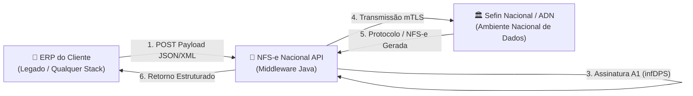

# NFS-e Nacional API

> **API REST para integração direta com o Ambiente Nacional da NFS-e (Sefin Nacional / ADN): emissão, consulta e cancelamento de DPS com assinatura A1 e mTLS.**

[-blue?style=flat-square)](#)
[-purple?style=flat-square)](#)

---

## 🎯 Sobre o Projeto

O **`nfse-nacional-api`** é um middleware de integração fiscal projetado para atuar como ponte intermediária e desacoplada entre sistemas ERP legados e os servidores do **Ambiente Nacional da NFS-e (Sefin Nacional e ADN - Ambiente de Dados Nacional)** da Receita Federal do Brasil.

Ele centraliza a complexidade da legislação e da segurança tributária brasileira:
* Validação semântica e estrutural contra os **Schemas Oficiais (XSD)**.
* **Assinatura Digital XML** da Declaração de Prestação de Serviços (DPS) com Certificado Digital ICP-Brasil A1 (PKCS#12).
* Comunicação segura via **mTLS (Mutual TLS)** com os WebServices/APIs nacionais.
* Exposição de endpoints REST simples em JSON para que qualquer ERP possa emitir notas sem lidar diretamente com certificados e criptografia XML.

---

## 🏛️ Fluxo de Integração

---

## 🚀 Funcionalidades do MVP

- [ ] **Emissão de DPS:** Envio síncrono e assíncrono de DPS gerando a NFS-e oficial.
- [ ] **Consulta de Notas & Lotes:** Consulta do status de processamento e recuperação do XML/DANFSE.
- [ ] **Eventos da Nota:** Registro de cancelamento e substituição de NFS-e.
- [ ] **Gerenciamento de Certificado A1:** Carga e leitura segura de certificados em memória sem persistência desprotegida.

---

## 🛠️ Stack Tecnológica & Pré-requisitos

* **Linguagem & Runtime:** Java 17+ (compatível com Tomcat 10+ / Servlet Container na BrasilCloud).
* **Segurança & Criptografia:** Java Cryptography Architecture (JCA), PKCS#12 e RSA-SHA256.
* **Comunicação Segura:** Handshake TLS mútuo (mTLS) com `SSLContext` dedicado.
* **Padrões de Projeto:** Spec-Driven Development (SDD), Clean Architecture e TDD.

---

## 📂 Documentação & Governança

Toda a evolução do projeto é gerida via **Docs-as-Code**:

* **[Backlog do Projeto](./docs/backlog.md):** Épicos, fatias verticais e status das tarefas.
* **[Especificações Técnicas (`docs/specs/`)](./docs/templates/SPEC.md):** Regras de negócio e contratos de cada fatia antes da codificação.
* **[Decisões Arquiteturais (`docs/adrs/`)](./docs/templates/ADR.md):** Registros formais de decisões técnicas (ADRs).
* **[Diretrizes de IA (`AGENTS.md`)](./AGENTS.md):** Regras e restrições operacionais para agentes de pair programming.

---

## 📄 Licença

Este projeto é distribuído sob a licença [MIT](./LICENSE).
