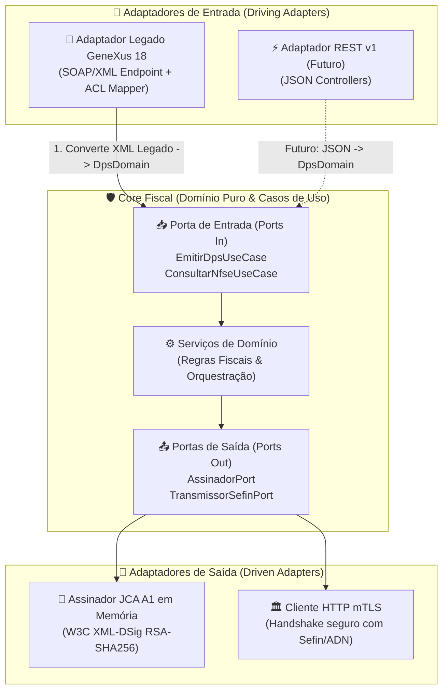

# ADR-004: Padrão Arquitetural (Hexagonal / Ports & Adapters com Camada Anticorrupção)

> **Status:** `Aprovado`
> **Data:** 2026-11-02
> **Decisores:** @heviane
> **Contexto Técnico:** Padrão Arquitetural de Software e Estratégia de Retrocompatibilidade para o ERP do Cliente

---

## 1. 📌 Contexto e Forças do Problema

Com a linguagem (**Java 17** / [ADR-001](./0001-escolha-linguagem-plataforma-java.md)), a ferramenta de build (**Maven** / [ADR-002](./0002-escolha-build-tool-maven-vs-gradle.md)) e o framework web (**Spring Boot 3 em WAR** / [ADR-003](./0003-framework-web-runtime-spring-boot.md)) estabelecidos, faz-se necessário definir a organização interna dos módulos, a separação de responsabilidades e a estratégia de convivência entre o cliente atual e a evolução do produto.

A decisão arquitetural é impulsionada pelas seguintes forças:

- **Força 1: Urgência Regulatória e Zero Impacto no Cliente Atual (Força Crítica)**
  A obrigatoriedade de emissão pelo Ambiente Nacional da NFS-e entrou em vigor imediatamente. O cliente atual consome um WebService SOAP construído anteriormente em GeneXus 18. Exigir alterações no ERP do cliente paralisaria a operação de faturamento. O middleware deve receber o mesmo payload XML/SOAP legado, de modo que o cliente apenas aponte para a nova URL da aplicação.

- **Força 2: Isolamento do Core Fiscal Nacional**
  A lógica tributária nacional (validação de schemas XSD da DPS, geração de hash XML-DSig, assinatura digital com certificado A1 e envio mTLS ao Sefin Nacional / ADN) é de alta complexidade e regulada por normas federais. Essa lógica **não deve ser acoplada nem poluída** por peculiaridades, nomenclaturas ou limitações do sistema legado do cliente.

- **Força 3: Expansão Comercial e Suporte Multi-Cliente (API REST Futura)**
  O produto foi concebido para atender múltiplos clientes no futuro. Ele deve suportar a adição de uma API REST padronizada (JSON + OpenAPI/Swagger) sem exigir refatorações no motor de emissão fiscal.

- **Força 4: Testabilidade Isolada do Framework**
  As regras de validação de schemas, assinatura digital e tratamento de erros do Sefin Nacional precisam ser testadas de forma pura e determinística em testes unitários rápidos, sem necessidade de carregar o contexto web do Spring ou servidores de aplicação.

---

## 2. 🎯 Decisão Tomada

> **Decidimos adotar o padrão arquitetural Ports & Adapters (Arquitetura Hexagonal) associado ao padrão Anti-Corruption Layer (ACL — Camada Anticorrupção).**

### 🏛️ Estrutura Conceitual & Camadas

### 📦 Mapeamento de Pacotes

1. **`core.domain`:** Entidades de domínio ricas e imutáveis (`Dps`, `Nfse`, `CertificadoDigital`, `RegraTributaria`). Zero dependência de frameworks.
2. **`core.ports.in`:** Interfaces dos casos de uso da aplicação (ex: `EmitirDpsUseCase`).
3. **`core.ports.out`:** Interfaces que declaram os serviços externos necessários (ex: `AssinadorDigitalPort`, `TransmissorSefinPort`).
4. **`core.services`:** Implementação dos casos de uso (validação de schemas XSD, acionamento do assinador e envio via transmissor).
5. **`adapters.in.legacy` (Camada Anticorrupção - ACL):**
   - Controlador que recebe o XML/SOAP legado do GeneXus 18.
   - Mapeador de tradução (_De/Para_) que converte o payload antigo para a entidade de domínio `Dps`.
   - Conversor de resposta que devolve o XML no layout SOAP antigo esperado pelo ERP.
6. **`adapters.in.rest`:** Controladores REST (`@RestController`) para atendimento de novos clientes via JSON (Fase posterior).
7. **`adapters.out.signer`:** Implementação da porta de assinatura via JCA nativo e W3C XML Signature.
8. **`adapters.out.sefin`:** Implementação da transmissão via cliente HTTP seguro com mTLS.

---

## 3. ⚖️ Consequências

### Consequências Positivas (Ganhos)

- **Continuidade Operacional do Cliente:** O cliente atual não precisa reescrever seu ERP nem alterar sua rotina; a Camada Anticorrupção absorve a diferença de formatos.
- **Pureza do Core Fiscal:** As regras federais do Sefin Nacional ficam totalmente desacopladas do GeneXus 18. Se o cliente atualizar seu ERP amanhã, o Core Fiscal permanece inalterado.
- **Extensibilidade e Baixo Acoplamento:** Incluir a API REST no futuro exigirá apenas criar os adaptadores REST em `adapters.in.rest`, sem tocar no código do Core Fiscal.
- **Alta Testabilidade:** É possível testar o Core Fiscal com dublês de teste (_mocks_ simples em JUnit 5) sem depender de conexões reais com a Receita Federal ou servidores web.

### Consequências Negativas (Custos / Trade-offs)

- **Multiplicação de Estruturas de Dados:** Existirão DTOs específicos para o SOAP legado, DTOs para a futura API REST e as Entidades de Domínio do Core, exigindo mappers explícitos de conversão.
- **Curva de Aprendizado Estrutural:** A separação estrita de camadas exige disciplina de engenharia para evitar "atalhos" (como acoplar anotações do Spring diretamente nas entidades de domínio).

### Riscos Mitigados

- Elimina o risco de criar um código confuso e monolítico onde regras fiscais federais fiquem misturadas com tags específicas do GeneXus 18.
- Mitiga o risco de retrabalho quando o projeto for comercializado para novos clientes com outros ERPs.

---

## 4. 🔍 Alternativas Consideradas

| Alternativa                                                                                    | Prós                                               | Contras                                                                                                                                                | Motivo da Rejeição                                              |
| :--------------------------------------------------------------------------------------------- | :------------------------------------------------- | :----------------------------------------------------------------------------------------------------------------------------------------------------- | :-------------------------------------------------------------- |
| **Arquitetura em Camadas Tradicional (Controller $\rightarrow$ Service $\rightarrow$ Client)** | Menor número inicial de arquivos e classes.        | Acopla o modelo do controller ao serviço; para suportar dois formatos (SOAP e REST), geraria código duplicado ou controladores cheios de condicionais. | Falta de escalabilidade arquitetural e alto risco de regressão. |
| **Monólito Focado Exclusivamente no GeneXus 18 (Abordagem "Rápida")**                          | Menos código inicial para atender o cliente atual. | Transforma o projeto em uma solução descartável de cliente único, inviabilizando o roadmap de transformá-lo em uma API REST pública.                   | Rejeitado por comprometer a visão de longo prazo do produto.    |
