# Cliente 001 — Dossiê Técnico do Serviço Legado em GeneXus 18 (SIL Tecnologia)

> **Documento:** Compilação técnica completa sobre o funcionamento, contratos, payloads e arquitetura do WebService legado construído em **GeneXus 18** pelo Cliente 001.  
> **Finalidade:** Servir como base de conhecimento técnico definitiva para sustentação, testes e evolução da **Camada Anticorrupção (ACL)** do `nfse-nacional-api`.  
> **Status:** Ativo / Homologado  
> **Data:** 2026-11-03  

---

## 1. 📌 Contexto de Negócio & Origem do Serviço

O Cliente 001 opera um sistema de gestão empresarial (ERP) desenvolvido em **GeneXus 18**. 

* **Município de Origem:** Vila Velha - ES.
* **Provedor Municipal Legado:** **SIL Tecnologia** (empresa prestadora do sistema de tributação e emissão de NFS-e municipal).
* **Motivo da Substituição:** A SEMFI (Secretaria Municipal de Finanças de Vila Velha) determinou, por meio da **Resolução CGSN nº 191/2026**, a obrigatoriedade de migração de micro e pequenas empresas para o **Emissor Nacional da NFS-e (Sefin Nacional / ADN)** a partir de 1º de novembro de 2026.
* **A Restrição Primária do Cliente:** O ERP do cliente estava em plena operação. Reescrever a integração de faturamento dentro do GeneXus para conversar diretamente com o Sefin Nacional exigiria semanas de desenvolvimento, paralisando a emissão de notas fiscais da empresa.
* **A Decisão:** Criar um middleware em Java com uma **Camada Anticorrupção (ACL)** capaz de emular com fidelidade o WebService municipal legado da SIL, de forma que o ERP GeneXus precise apenas alterar a URL de destino da prefeitura para a URL da nossa API.

---

## 2. 🏛️ Arquitetura do Serviço Legado GeneXus

No GeneXus 18, a comunicação com WebServices SOAP é estruturada via **WSDL Import** (que gera automaticamente tipos de dados estruturados — *SDTs* e objetos de conexão SOAP):

```mermaid
flowchart LR
    subgraph ERP_GX["🏢 ERP do Cliente (GeneXus 18)"]
        direction TB
        DB[(Banco de Dados\nERP)] --> OBJ_FAT["Rotina de Faturamento\n(GeneXus Object)"]
        OBJ_FAT --> SDT["Preenche SDT / XML de Envio"]
        SDT --> WSDL_CLIENT["Cliente SOAP Nativo\n(siltecnologia.com.br)"]
    end

    subgraph MIDDLEWARE["🛡️ nfse-nacional-api (Tomcat)"]
        direction TB
        ENDPOINT["/prefeitura/notafiscal/nfse.asmx\n(LegacySoapController)"]
        PARSER["Parser Inteligente\n(Extração CDATA / Entidades)"]
        CORE["Core Fiscal Nacional\n(Validação XSD v1.00 + RSA-SHA256)"]
        MTLS["Cliente HTTP mTLS\n(SSLContext com Certificado A1)"]

        ENDPOINT --> PARSER --> CORE --> MTLS
    end

    subgraph RECEITA["🏛️ Sefin Nacional / ADN"]
        SEFIN["API REST Sefin Nacional\n(/API/SefinNacional/dps)"]
    end

    WSDL_CLIENT -- "1. POST SOAP XML (Envelope SIL)" --> ENDPOINT
    MTLS -- "2. POST REST JSON (GZIP Base64)" --> SEFIN
    SEFIN -- "3. HTTP 200 (JSON + Chave 50 dígitos)" --> MTLS
    ENDPOINT -- "4. Retorno SOAP XML (Formato SIL)" --> WSDL_CLIENT
```



---

## 3. 📜 Contrato do WebService (WSDL & Assinatura SOAP)

O WebService municipal da SIL Tecnologia era baseado no padrão **ASMX (.NET WebService)** clássico:

* **Endpoint URL:** `/prefeitura/notafiscal/nfse.asmx`
* **Definição WSDL:** `/prefeitura/notafiscal/nfse.asmx?WSDL`
* **Target Namespace:** `http://www.siltecnologia.com.br/`
* **Estilo / Binding:** Document / Literal (SOAP 1.1 e compatível com SOAP 1.2)
* **Operação de Emissão:** `GerarNfse`
* **SoapAction:** `http://www.siltecnologia.com.br/GerarNfse`

### 3.1. Estrutura do WSDL Emulado

O nosso controlador [`LegacySoapController.java`](../../src/main/java/br/com/heviane/nfse/adapters/in/legacy/LegacySoapController.java) serve em runtime a seguinte definição XML para qualquer consulta `GET /prefeitura/notafiscal/nfse.asmx?WSDL`:

```xml
<?xml version="1.0" encoding="utf-8"?>
<wsdl:definitions xmlns:s="http://www.w3.org/2001/XMLSchema"
                  xmlns:soap12="http://schemas.xmlsoap.org/wsdl/soap12/"
                  xmlns:http="http://schemas.xmlsoap.org/wsdl/http/"
                  xmlns:mime="http://schemas.xmlsoap.org/wsdl/mime/"
                  xmlns:tns="http://www.siltecnologia.com.br/"
                  xmlns:soap="http://schemas.xmlsoap.org/wsdl/soap/"
                  targetNamespace="http://www.siltecnologia.com.br/"
                  xmlns:wsdl="http://schemas.xmlsoap.org/wsdl/">
  <wsdl:types>
    <s:schema elementFormDefault="qualified" targetNamespace="http://www.siltecnologia.com.br/">
      <s:element name="GerarNfse">
        <s:complexType>
          <s:sequence>
            <s:element minOccurs="0" maxOccurs="1" name="xmlEnvio" type="s:string" />
          </s:sequence>
        </s:complexType>
      </s:element>
      <s:element name="GerarNfseResponse">
        <s:complexType>
          <s:sequence>
            <s:element minOccurs="0" maxOccurs="1" name="GerarNfseResult" type="s:string" />
          </s:sequence>
        </s:complexType>
      </s:element>
    </s:schema>
  </wsdl:types>
  <wsdl:message name="GerarNfseSoapIn">
    <wsdl:part name="parameters" element="tns:GerarNfse" />
  </wsdl:message>
  <wsdl:message name="GerarNfseSoapOut">
    <wsdl:part name="parameters" element="tns:GerarNfseResponse" />
  </wsdl:message>
  <wsdl:portType name="NfseSoap">
    <wsdl:operation name="GerarNfse">
      <wsdl:input message="tns:GerarNfseSoapIn" />
      <wsdl:output message="tns:GerarNfseSoapOut" />
    </wsdl:operation>
  </wsdl:portType>
  <wsdl:binding name="NfseSoap" type="tns:NfseSoap">
    <soap:binding transport="http://schemas.xmlsoap.org/soap/http" />
    <wsdl:operation name="GerarNfse">
      <soap:operation soapAction="http://www.siltecnologia.com.br/GerarNfse" style="document" />
      <wsdl:input>
        <soap:body use="literal" />
      </wsdl:input>
      <wsdl:output>
        <soap:body use="literal" />
      </wsdl:output>
    </wsdl:operation>
  </wsdl:binding>
  <wsdl:service name="Nfse">
    <wsdl:port name="NfseSoap" binding="tns:NfseSoap">
      <soap:address location="http://localhost:8080/prefeitura/notafiscal/nfse.asmx" />
    </wsdl:port>
  </wsdl:service>
</wsdl:definitions>
```

---

## 4. 📦 Especificação de Payloads (Entrada e Saída)

### 4.1. Payload de Requisição Enviado pelo GeneXus (`GerarNfse`)

O GeneXus 18 monta um envelope SOAP contendo o método `<sil:GerarNfse>`. O conteúdo fiscal da declaração é enviado no campo `<sil:xmlEnvio>`, que pode ser transmitido como bloco **`CDATA`** ou com caracteres XML escapados em entidades HTML (`&lt;` e `&gt;`).

Exemplo real sanitizado ([`src/test/resources/samples/envelope-soap-genexus.xml`](../../src/test/resources/samples/envelope-soap-genexus.xml)):

```xml
<?xml version="1.0" encoding="utf-8"?>
<soapenv:Envelope xmlns:soapenv="http://schemas.xmlsoap.org/soap/envelope/" xmlns:sil="http://www.siltecnologia.com.br/">
  <soapenv:Header/>
  <soapenv:Body>
    <sil:GerarNfse>
      <sil:xmlEnvio><![CDATA[<?xml version="1.0" encoding="UTF-8"?>
<DPS xmlns="http://www.sped.fazenda.gov.br/nfse" versao="1.00">
  <infDPS Id="DPS320520020000000000019100001000000000000001">
    <tpAmb>2</tpAmb>
    <dhEmi>2026-11-02T17:00:00-03:00</dhEmi>
    <verAplic>ERP_v1.00</verAplic>
    <serie>00001</serie>
    <nDPS>1</nDPS>
    <dCompet>2026-11-02</dCompet>
    <tpEmit>1</tpEmit>
    <cLocEmi>3205200</cLocEmi>
    <prest>
      <CNPJ>00000000000191</CNPJ>
      <IM>12345</IM>
      <xNome>EMPRESA PRESTADORA DE SERVICOS LTDA</xNome>
      <fone>27999998888</fone>
      <email>contato@prestadordeexemplo.com.br</email>
      <regTrib>
        <opSimpNac>1</opSimpNac>
        <regApTribSN>1</regApTribSN>
        <regEspTrib>0</regEspTrib>
      </regTrib>
    </prest>
    <toma>
      <CNPJ>99999999000191</CNPJ>
      <xNome>TOMADOR DE SERVICOS TESTE LTDA</xNome>
      <end>
        <endNac>
          <cMun>3205309</cMun>
          <CEP>29010000</CEP>
        </endNac>
        <xLgr>AVENIDA EXEMPLO</xLgr>
        <nro>100</nro>
        <xBairro>CENTRO</xBairro>
      </end>
    </toma>
    <serv>
      <locPrest>
        <cLocPrestacao>3205200</cLocPrestacao>
      </locPrest>
      <cServ>
        <cTribNac>010301</cTribNac>
        <cTribMun>700</cTribMun>
        <xDescServ>Servicos de desenvolvimento e licencamento de programas de computador.</xDescServ>
      </cServ>
    </serv>
    <valores>
      <vServPrest>
        <vServ>100.00</vServ>
      </vServPrest>
      <trib>
        <tribMun>
          <tribISSQN>1</tribISSQN>
          <tpRetISSQN>2</tpRetISSQN>
          <pAliq>2.50</pAliq>
        </tribMun>
        <tribFed>
          <piscofins>
            <CST>07</CST>
            <vBCPisCofins>0.00</vBCPisCofins>
            <pAliqPis>0.00</pAliqPis>
            <pAliqCofins>0.00</pAliqCofins>
            <vPis>0.00</vPis>
            <vCofins>0.00</vCofins>
            <tpRetPisCofins>2</tpRetPisCofins>
          </piscofins>
        </tribFed>
        <totTrib>
          <indTotTrib>0</indTotTrib>
        </totTrib>
      </trib>
    </valores>
  </infDPS>
</DPS>]]></sil:xmlEnvio>
    </sil:GerarNfse>
  </soapenv:Body>
</soapenv:Envelope>
```

---

### 4.2. Payload de Resposta de Sucesso Esperado pelo GeneXus (`GerarNfseResult`)

O leitor XML do GeneXus espera um envelope SOAP com o elemento `<GerarNfseResponse>`, dentro do qual se encontra a string `<GerarNfseResult>`. Esta string encapsula a estrutura `<RetornoEmissao>` com o status e a chave da nota:

```xml
<?xml version="1.0" encoding="utf-8"?>
<soap:Envelope xmlns:soap="http://schemas.xmlsoap.org/soap/envelope/" xmlns:xsi="http://www.w3.org/2001/XMLSchema-instance" xmlns:xsd="http://www.w3.org/2001/XMLSchema">
  <soap:Body>
    <GerarNfseResponse xmlns="http://www.siltecnologia.com.br/">
      <GerarNfseResult>
        &lt;RetornoEmissao&gt;
          &lt;Sucesso&gt;true&lt;/Sucesso&gt;
          &lt;CodigoStatus&gt;100&lt;/CodigoStatus&gt;
          &lt;MotivoStatus&gt;NFS-e gerada com sucesso&lt;/MotivoStatus&gt;
          &lt;ChaveAcesso&gt;32052002601000000000019100001000000000000001123456&lt;/ChaveAcesso&gt;
          &lt;XmlNfse&gt;&amp;lt;NFSe versao="1.00"&amp;gt;...&amp;lt;/NFSe&amp;gt;&lt;/XmlNfse&gt;
        &lt;/RetornoEmissao&gt;
      </GerarNfseResult>
    </GerarNfseResponse>
  </soap:Body>
</soap:Envelope>
```

#### Campos Retornados no `RetornoEmissao`:
* `<Sucesso>`: Booleano (`true` ou `false`).
* `<CodigoStatus>`: Código numérico de status (ex: `100` para autorizada no Sefin Nacional, ou `999` para falha).
* `<MotivoStatus>`: Mensagem descritiva do resultado da transmissão.
* `<ChaveAcesso>`: **Chave de Acesso Nacional de 50 dígitos numéricos** (atribuída pelo Ambiente Nacional).
* `<XmlNfse>`: XML oficial da nota autorizada, já descompactado do GZIP original e com caracteres escapados para manter a integridade dentro do nó SOAP.

---

### 4.3. Payload de Resposta de Erro Tratado

Se houver uma rejeição de schema (XSD), erro de certificado ou falha de comunicação com o Sefin Nacional, a Camada Anticorrupção devolve o mesmo contrato SOAP, permitindo que a tela do GeneXus capture e exiba o motivo da rejeição sem quebrar com `SoapFault` fatal:

```xml
<?xml version="1.0" encoding="utf-8"?>
<soap:Envelope xmlns:soap="http://schemas.xmlsoap.org/soap/envelope/" xmlns:xsi="http://www.w3.org/2001/XMLSchema-instance" xmlns:xsd="http://www.w3.org/2001/XMLSchema">
  <soap:Body>
    <GerarNfseResponse xmlns="http://www.siltecnologia.com.br/">
      <GerarNfseResult>
        &lt;RetornoEmissao&gt;
          &lt;Sucesso&gt;false&lt;/Sucesso&gt;
          &lt;CodigoStatus&gt;999&lt;/CodigoStatus&gt;
          &lt;MotivoStatus&gt;Falha na validação do schema XSD: O campo cTribNac é obrigatório.&lt;/MotivoStatus&gt;
        &lt;/RetornoEmissao&gt;
      </GerarNfseResult>
    </GerarNfseResponse>
  </soap:Body>
</soap:Envelope>
```

---

## 5. 🔍 Estratégias do Parser Inteligente na Camada Anticorrupção

Na prática, diferentes geradores GeneXus e bibliotecas HTTP podem enviar o XML da DPS de formas sutis distintas. Por isso, o método `extrairXmlDps(String payload)` do nosso controlador implementa três mecanismos de tolerância a falhas:

1. **Decodificação Prévia de Entidades:** Identifica se o XML foi enviado escapado com `&lt;DPS...` e normaliza para `<DPS...`.
2. **Extração da Raiz `<DPS>`:** Localiza o início em `<DPS` e o fechamento em `</DPS>`, extraindo a árvore completa mesmo se o envelope contiver nós irmãos ou atributos XML extras.
3. **Suporte a Envio Apenas da `<infDPS>`:** Se o GeneXus legar apenas o nó `<infDPS>` sem o nó pai `<DPS>`, o parser detecta `<infDPS...` e injeta automaticamente a casca raiz `<DPS xmlns="http://www.sped.fazenda.gov.br/nfse" versao="1.00">`, garantindo validação perfeita no schema XSD oficial.

---

## 6. 🛠️ Como o Cliente 001 Realiza a Virada no GeneXus

Graças à Camada Anticorrupção (ACL), a homologação e a entrada em produção exigem **zero linhas de código ou compilação no GeneXus**:

### Procedimento no ERP GeneXus:
1. Acessar a tela/tabela de parâmetros de WebService do ERP (ex: *Parâmetros Fiscais / Emissão NFS-e*).
2. Localizar o campo **URL do WebService**.
3. **Para Testes Locais (via Túnel ou Rede Local):**
   ```text
   http://localhost:8080/prefeitura/notafiscal/nfse.asmx
   ```
   *(ou a URL gerada pelo túnel HTTPS do Cloudflare/ngrok)*.
4. **Para Produção (no Servidor Tomcat da BrasilCloud):**
   ```text
   https://<dominio-ou-ip-brasilcloud>/prefeitura/notafiscal/nfse.asmx
   ```
5. Salvar o parâmetro e emitir uma nota de teste.
