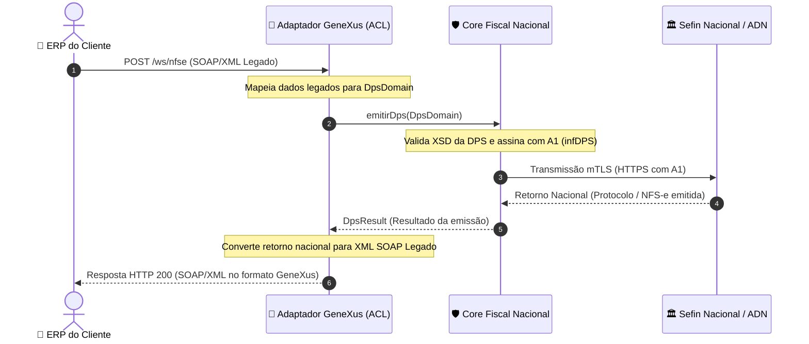

# Cliente 001 — Contexto de Negócio, Topologia & Integração

> **Status:** `Ativo / Em Implantação Inicial`  
> **Modelo Comercial:** Desenvolvimento sob demanda (*Work-for-hire*)  
> **Data de Documentação:** 2026-11-02  
> **Responsável Técnico:** @heviane

---

## 1. 📌 Visão Geral & Contexto de Negócio

O **Cliente 001** contratou o desenvolvimento do middleware de integração com a NFS-e Nacional sob o modelo de código sob demanda (*work-for-hire*). 

* **Urgência Regulatória:** A obrigatoriedade de emissão pelo **Ambiente Nacional da NFS-e (Sefin Nacional / ADN)** entrou em vigor imediatamente, exigindo uma solução em produção no menor prazo possível.
* **Restrição Primária de Negócio:** **Zero modificações no ERP do cliente.** O cliente já possui um sistema em produção que consome um WebService SOAP em XML construído anteriormente em GeneXus 18. Exigir atualizações no ERP paralisaria o faturamento da empresa.
* **Solução Adotada:** O middleware atuará como um emulador e tradutor transparente. O ERP do cliente apenas substituirá a URL do WebService antigo pela URL desta nova API, mantendo o mesmo payload SOAP/XML de envio e recebendo o mesmo formato de resposta.

---

## 2. 🏛️ Topologia de Hospedagem & Infraestrutura

* **Provedor de Nuvem:** **BrasilCloud** (em conta gerenciada e mantida pelo próprio cliente).
* **Servidor de Aplicação:** **Apache Tomcat 10+** (suporte nativo à especificação Jakarta EE).
* **Linguagem & Runtime:** **Java 17 (OpenJDK)**.
* **Modelo de Empacotamento:** Arquivo **WAR** (`nfse-nacional-api.war`) implantado no diretório `webapps/` do Tomcat.
* **Custódia & Responsabilidade:** Como o servidor pertence ao cliente, a guarda do Certificado Digital A1, a chave privada e a responsabilidade perante a LGPD e o sigilo fiscal permanecem no perímetro de segurança do cliente.

---

## 3. 🔄 Fluxo de Integração & Camada Anticorrupção (ACL)

A comunicação obedece à [ADR-004](../adrs/0004-padrao-arquitetural-hexagonal-acl.md) (Arquitetura Hexagonal com Camada Anticorrupção):



---

## 4. ⚙️ Variáveis de Ambiente no Servidor (`setenv.sh`)

Para garantir que nenhuma credencial ou caminho absoluto fique chumbado no código-fonte, a configuração no Tomcat do cliente é realizada via variáveis de ambiente no arquivo de inicialização do Tomcat (`bin/setenv.sh`):

| Variável | Descrição | Exemplo de Valor |
| :--- | :--- | :--- |
| `NFSE_ENVIRONMENT` | Ambiente de emissão | `HOMOLOGACAO` ou `PRODUCAO` |
| `NFSE_CERT_PATH` | Caminho seguro do arquivo do certificado A1 no servidor | `/opt/certs/certificado_cliente001.pfx` |
| `NFSE_CERT_PASSWORD` | Senha de proteção do certificado A1 | *(configurada diretamente no servidor)* |
| `NFSE_LOG_LEVEL` | Nível de detalhamento de logs da aplicação | `INFO` ou `DEBUG` |

> [!CAUTION]
> **Segurança:** O arquivo real do certificado digital (`*.pfx` ou `*.p12`) e sua senha **NUNCA** devem ser comitados no repositório Git. Eles devem ser inseridos manualmente no servidor de produção pelo administrador/desenvolvedora.

---

## 5. 🚀 Procedimento Operacional de Deploy (Manual — Fase 1)

Atendendo à urgência imediata do Cliente 001 e familiaridade operacional:

1. **Geração do Artefato:**
   ```bash
   ./mvnw clean package -DskipTests
   ```
   *O Maven gerará o arquivo `target/nfse-nacional-api.war`.*
2. **Acesso à BrasilCloud:** Conectar ao servidor do cliente via painel de controle da BrasilCloud ou cliente SFTP seguro com as credenciais fornecidas pelo cliente.
3. **Publicação no Tomcat:**
   - Parar temporariamente o contexto da aplicação no Tomcat Manager ou substituir o arquivo em `webapps/nfse-nacional-api.war`.
   - Garantir que o Tomcat descompacte o novo WAR.
4. **Verificação de Saúde (*Smoke Test*):**
   - Acessar a rota de integridade: `http(s)://<dominio-brasilcloud>/nfse-nacional-api/health`
   - Confirmar se o status retornado é `UP` e o certificado A1 foi validado em memória com sucesso.
5. **Teste de Emissão de DPS:**
   - Disparar uma emissão de teste no ambiente de homologação a partir do ERP para validar a ponta a ponta.

---

## 6. 🔮 Roadmap para o Cliente 001

- [ ] Obter e armazenar amostra do XML SOAP real enviado pelo ERP para desenhar o mapeamento exato de campos (*De/Para*).
- [ ] Implementar endpoint de compatibilidade SOAP em `adapters.in.legacy`.
- [ ] Futuro: Automatizar este processo de deploy via **GitHub Actions (CI/CD)** via SSH/SFTP.
