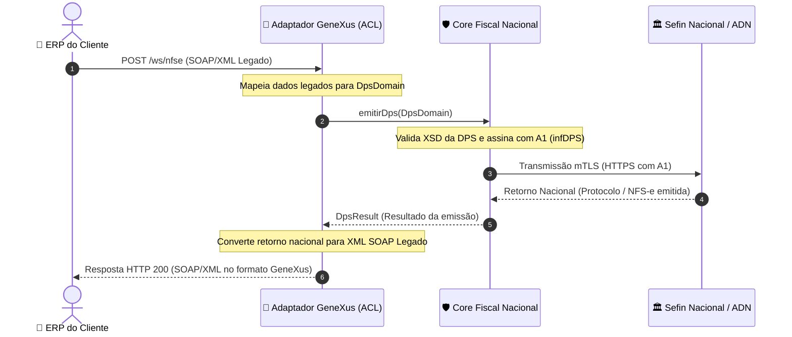

# Cliente 001 — Contexto de Negócio, Topologia & Integração

> **Status:** `Ativo / Em Implantação Inicial`  
> **Modelo Comercial:** Desenvolvimento sob demanda (*Work-for-hire*)  
> **Data de Documentação:** 2026-11-02  
> **Responsável Técnico:** @heviane  
> **Origem / Município:** Vila Velha - ES (Transição SIL Tecnologia &rarr; Sefin Nacional)

---

## 1. 📌 Visão Geral & Contexto de Negócio

O **Cliente 001** contratou o desenvolvimento do middleware de integração com a NFS-e Nacional sob o modelo de código sob demanda (*work-for-hire*). 

* **Urgência Regulatória:** A obrigatoriedade de emissão pelo **Ambiente Nacional da NFS-e (Sefin Nacional / ADN)** entrou em vigor imediatamente, exigindo uma solução em produção no menor prazo possível.
* **Restrição Primária de Negócio:** **Zero modificações no ERP do cliente.** O cliente já possui um sistema em produção que consome um WebService SOAP em XML construído anteriormente em GeneXus 18. Exigir atualizações no ERP paralisaria o faturamento da empresa.
* **Solução Adotada:** O middleware atuará como um emulador e tradutor transparente. O ERP do cliente apenas substituirá a URL do WebService antigo pela URL desta nova API, mantendo o mesmo payload SOAP/XML de envio e recebendo o mesmo formato de resposta.

---

## 2. 🏛️ Contexto Municipal & Origem da Migração (Vila Velha - ES / SIL Tecnologia)

A necessidade de migração decorre da **Resolução CGSN nº 191/2026**, formalizada pela Secretaria Municipal de Finanças (SEMFI) da **Prefeitura Municipal de Vila Velha (PMVV)**:

> *"A Prefeitura de Vila Velha, por meio da Secretaria Municipal de Finanças (SEMFI), informa que, a partir de 1º de novembro de 2026, as microempresas (ME) e empresas de pequeno porte (EPP) optantes pelo Simples Nacional deverão emitir suas Notas Fiscais de Serviços eletrônicas (NFS-e) pelo Emissor Nacional, conforme a Resolução CGSN nº 191/2026."*

### 🔄 Transição: Provedor Municipal SIL vs. Emissor Nacional Sefin/ADN

| Aspecto | Sistema Anterior (SIL Tecnologia / Vila Velha) | Novo Padrão Nacional (Sefin / ADN) | Impacto no Middleware |
| :--- | :--- | :--- | :--- |
| **Protocolo** | SOAP / XML (`/prefeitura/notafiscal/nfse.asmx`) | REST / JSON com mTLS | Camada Anticorrupção (ACL) recebe SOAP e envia REST. |
| **Envelope de Envio** | Montava casca completa `<NFSe><infNFSe>...<DPS>` | Envio **estritamente da `<DPS>`** assinada | O Core Fiscal assina apenas a `<DPS>`, sem gerar `<NFSe>`. |
| **Id da DPS** | `infDPS Id="DPS..."` (45 posições) | Mantido: `infDPS Id="DPS..."` (45 posições: literal `DPS` + 42 dígitos numéricos) | Compatibilidade direta na identificação da declaração (XSD `TSIdDPS`). |
| **Chave da Nota** | Formato local de 53 posições iniciado por `NFS...` | **Chave de Acesso Nacional de 50 dígitos numéricos** | Retorno nacional convertido para o formato esperado pelo ERP. |
| **Cancelamento** | Referência interna municipal | Evento `101101` com `<chNFSe>` de 50 dígitos | Eventos exigem a chave nacional retornada na emissão. |

### 📋 Parametrizações Específicas do Emitente (Simples Nacional)
* **Regime Tributário:** Preenchimento obrigatório de `opSimpNac = 1` (Optante Simples Nacional) e `regApTribSN = 1` (Regime de apuração) no nó `<prest><regTrib>`.
* **Tributação Federal:** Informar `tpRetPisCofins = 2` (sem retenção de PIS/COFINS na fonte).
* **Reforma Tributária (IBS/CBS):** As regras relativas ao IBS e CBS para o Simples Nacional passam a vigorar a partir de **2027**. Para o envio em 2026, a aplicação valida esquemas atualizados sem destacar alíquotas cheias desses novos tributos.

---

## 3. ☁️ Topologia de Hospedagem & Infraestrutura

* **Provedor de Nuvem:** **BrasilCloud** (em conta gerenciada e mantida pelo próprio cliente).
* **Servidor de Aplicação:** **Apache Tomcat 10.1+** (suporte mandatório a Jakarta EE 10 / Servlet 6.0, exigido pelo Spring Boot 3.3; Tomcat 10.0 suporta apenas Servlet 5.0 e é incompatível).
* **Linguagem & Runtime:** **Java 17 (OpenJDK)**.
* **Modelo de Empacotamento:** Arquivo **WAR** (`nfse-nacional-api.war`) implantado no diretório `webapps/` do Tomcat.
* **Custódia & Responsabilidade:** Como o servidor pertence ao cliente, a guarda do Certificado Digital A1, a chave privada e a responsabilidade perante a LGPD e o sigilo fiscal permanecem no perímetro de segurança do cliente.

---

## 4. 🔄 Fluxo de Integração & Camada Anticorrupção (ACL)

A comunicação obedece à [ADR-004](../adrs/0004-padrao-arquitetural-hexagonal-acl.md) (Arquitetura Hexagonal com Camada Anticorrupção):



---

## 5. ⚙️ Variáveis de Ambiente no Servidor (`setenv.sh`)

Para garantir que nenhuma credencial ou caminho absoluto fique chumbado no código-fonte, a configuração no Tomcat do cliente é realizada via variáveis de ambiente no arquivo de inicialização do Tomcat (`bin/setenv.sh`):

| Variável | Descrição | Exemplo de Valor |
| :--- | :--- | :--- |
| `NFSE_ENVIRONMENT` | Ambiente de emissão | `HOMOLOGACAO` ou `PRODUCAO` |
| `NFSE_CERT_PATH` | Caminho do arquivo `.pfx`/`.p12` no disco — **Recomendado para Tomcat/Linux** | `/opt/certs/certificado_cliente001.pfx` |
| `NFSE_CERT_PASSWORD` | Senha de proteção do certificado A1 | *(configurada diretamente no servidor)* |
| `NFSE_CERT_BASE64` | *(Alternativa para containers)* Conteúdo do certificado digital A1 em Base64 | `MIIK...` |
| `NFSE_API_KEY` | Chave secreta de autenticação do middleware (opcional se isolado por firewall) | `chave-secreta-erp-cliente001` |
| `NFSE_ALLOW_CERT_HEADERS` | Permite envio de certificados via headers HTTP (padrão `false` por segurança) | `false` |
| `NFSE_SOAP_ADDRESS_LOCATION` | URL pública do endpoint SOAP no WSDL (opcional, gerada dinamicamente por padrão) | `https://fiscal.cliente001.com.br/prefeitura/notafiscal/nfse.asmx` |
| `SERVER_SERVLET_CONTEXT_PATH` | Prefixo de contexto do servlet (opcional; padrão vazio para atender na raiz `/`) | `/` ou `/nfse-nacional-api` |
| `NFSE_LOG_LEVEL` | Nível de detalhamento de logs da aplicação | `INFO` ou `DEBUG` |

> [!TIP]
> **Prática Recomendada no Linux / Tomcat (BrasilCloud):**
> Salvar o certificado A1 em diretório protegido no servidor e aplicar permissões restritas:
> ```bash
> sudo mkdir -p /opt/certs
> sudo chown tomcat:tomcat /opt/certs/certificado_cliente001.pfx
> sudo chmod 600 /opt/certs/certificado_cliente001.pfx
> ```
> O uso de `NFSE_CERT_PATH` com permissão `600` impede que outros usuários do sistema leiam a chave privada e evita a exposição do Base64 completo em `/proc/<pid>/environ` ou dumps de configuração.

> [!CAUTION]
> **Segurança:** O arquivo real do certificado digital (`*.pfx` ou `*.p12`) e sua senha **NUNCA** devem ser comitados no repositório Git. Eles devem ser inseridos manualmente no servidor de produção pelo administrador/desenvolvedora via `setenv.sh`.

---

## 6. 🚀 Procedimento Operacional de Deploy (Manual — Fase 1)

Atendendo à urgência imediata do Cliente 001 e familiaridade operacional com o ambiente Linux / Tomcat:

### 📦 Passo 1: Geração do Artefato em Ambiente Local
Execute o build do pacote WAR ignorando a execução de testes locais (que já foram validados na suíte de CI):
```bash
mvn clean package -DskipTests
```
*O Maven gerará o arquivo executável em `target/nfse-nacional-api.war`.*

### 💾 Passo 2: Backup Preventivo Obrigatório no Servidor (BrasilCloud)
Antes de interromper o Tomcat ou substituir qualquer arquivo, conecte ao servidor via SSH e realize a salvaguarda da versão atual em execução:
```bash
# 1. Definir variáveis do Tomcat e timestamp de backup
export TOMCAT_HOME="/opt/tomcat"
export BACKUP_DIR="/opt/tomcat/backups/$(date +%Y%m%d_%H%M%S)"
sudo mkdir -p "$BACKUP_DIR"

# 2. Copiar o WAR atual e o script de variáveis de ambiente
if [ -f "$TOMCAT_HOME/webapps/ROOT.war" ]; then
    sudo cp -p "$TOMCAT_HOME/webapps/ROOT.war" "$BACKUP_DIR/ROOT.war"
fi
if [ -f "$TOMCAT_HOME/webapps/nfse-nacional-api.war" ]; then
    sudo cp -p "$TOMCAT_HOME/webapps/nfse-nacional-api.war" "$BACKUP_DIR/nfse-nacional-api.war"
fi
if [ -f "$TOMCAT_HOME/bin/setenv.sh" ]; then
    sudo cp -p "$TOMCAT_HOME/bin/setenv.sh" "$BACKUP_DIR/setenv.sh"
fi

echo "Backup concluído com sucesso em: $BACKUP_DIR"
```

### 🛑 Passo 3: Parada Limpa e Limpeza de Cache (*Clean Deploy*)
Para evitar conflito de classes em cache ou vazamentos de memória na atualização do WAR:
```bash
# 1. Parar o serviço do Tomcat
sudo systemctl stop tomcat

# 2. Limpar o diretório expandido da aplicação anterior e pastas de trabalho temporárias
sudo rm -rf "$TOMCAT_HOME/webapps/ROOT"
sudo rm -rf "$TOMCAT_HOME/webapps/nfse-nacional-api"
sudo rm -rf "$TOMCAT_HOME/work/Catalina/localhost/*"
sudo rm -rf "$TOMCAT_HOME/temp/*"
```

### 📤 Passo 4: Publicação do Novo Artefato WAR
Envie o arquivo `target/nfse-nacional-api.war` via SFTP ou `scp` para o servidor:
```bash
# Exemplo via SCP a partir da sua máquina local:
scp target/nfse-nacional-api.war usuario@<ip-brasilcloud>:/tmp/nfse-nacional-api.war

# No servidor, publicar no diretório webapps:
# Opção A (Recomendada - Raiz Tomcat /):
sudo cp /tmp/nfse-nacional-api.war "$TOMCAT_HOME/webapps/ROOT.war"
sudo chown tomcat:tomcat "$TOMCAT_HOME/webapps/ROOT.war"
sudo chmod 644 "$TOMCAT_HOME/webapps/ROOT.war"
```

### 🚀 Passo 5: Inicialização e Monitoramento dos Logs
Inicie o serviço do Tomcat e acompanhe a inicialização do contexto Spring Boot:
```bash
sudo systemctl start tomcat
sudo tail -f "$TOMCAT_HOME/logs/catalina.out"
```
*Certifique-se de que a mensagem `Started NfseApplication in ... seconds` é exibida sem exceções fatais.*

### ✅ Passo 6: Verificação de Saúde (*Smoke Test*)
1. Acesse o endpoint do Actuator:
   ```bash
   curl -i http://localhost:8080/actuator/health
   # Retorno esperado: HTTP 200 {"status":"UP"}
   ```
2. Realize uma chamada de teste de emissão no ambiente de homologação a partir do ERP GeneXus apontando para `/prefeitura/notafiscal/nfse.asmx`.

---

### 6.1. ⏪ Plano de Rollback Imediato (Garantia de Continuidade Fiscal)

Caso a nova versão apresente falha crítica de inicialização ou inconsistência de integração com o ERP que impeça o faturamento, execute o rollback imediato em menos de 2 minutos:

#### 🚨 Gatilhos para Acionamento do Rollback:
- O endpoint `/actuator/health` não retorna status `UP` após 60 segundos da inicialização.
- Exceção fatal `CrashLoop` ou `ClassNotFoundException` persistente no `catalina.out`.
- Rejeição estrutural generalizada no ERP durante o primeiro envio de teste em homologação.

#### 🛠️ Procedimento Operacional de Rollback:
```bash
# 1. Parar imediatamente o Tomcat
sudo systemctl stop tomcat

# 2. Localizar o backup mais recente gerado no Passo 2
LATEST_BACKUP=$(ls -td /opt/tomcat/backups/*/ | head -1)
echo "Restaurando backup de: $LATEST_BACKUP"

# 3. Remover a versão com falha e caches residuais
sudo rm -rf "$TOMCAT_HOME/webapps/ROOT.war" "$TOMCAT_HOME/webapps/ROOT"
sudo rm -rf "$TOMCAT_HOME/work/Catalina/localhost/*"
sudo rm -rf "$TOMCAT_HOME/temp/*"

# 4. Restaurar o artefato WAR da versão anterior estável
if [ -f "${LATEST_BACKUP}ROOT.war" ]; then
    sudo cp -p "${LATEST_BACKUP}ROOT.war" "$TOMCAT_HOME/webapps/ROOT.war"
elif [ -f "${LATEST_BACKUP}nfse-nacional-api.war" ]; then
    sudo cp -p "${LATEST_BACKUP}nfse-nacional-api.war" "$TOMCAT_HOME/webapps/nfse-nacional-api.war"
fi

# 5. Reiniciar o Tomcat
sudo systemctl start tomcat

# 6. Validar restauração
curl -i http://localhost:8080/actuator/health
```
Após o restabelecimento do status `UP`, colete os logs de erro (`logs/catalina.out` e `logs/audit-fiscal.log`) para análise da equipe de desenvolvimento sem impacto operacional no cliente.

---

## 7. 🛡️ Diretrizes Mandatórias de Segurança na Nuvem (BrasilCloud)

Para garantir proteção fiscal integral sem depender exclusivamente da aplicação:

1. **Firewall / Whitelist de IP (Perímetro da BrasilCloud):**
   - No painel de controle ou firewall da BrasilCloud, configurar regras de entrada liberando as portas `80` e `443` **exclusivamente para o endereço IP fixo de saída do servidor onde roda o ERP GeneXus do Cliente 001**.
   - Bloquear todo tráfego público e conexões de origens não autorizadas.
2. **HTTPS / TLS 1.2+ Obrigatório:**
   - O Apache Tomcat deve operar atrás de um Reverse Proxy (Nginx, Apache HTTP Server ou WAF) com certificado SSL/TLS válido.
   - Redirecionar todo tráfego HTTP em texto claro para HTTPS.
3. **Chave de Autenticação (`NFSE_API_KEY`):**
   - Caso o ERP GeneXus envie o cabeçalho `X-API-Key` ou `Authorization: Basic / Bearer`, configurar a variável `NFSE_API_KEY` no `setenv.sh`. O middleware rejeitará com HTTP 401 qualquer chamada não autorizada.
4. **Isolamento de Certificados:**
   - Manter `NFSE_ALLOW_CERT_HEADERS=false` (padrão) para evitar que certificados e senhas trafeguem pela rede ou sejam capturados em logs de proxy reverso.

## 8. 🔮 Próximos Passos para o Cliente 001

- [x] Obter e analisar amostra do XML SOAP real enviado pelo ERP: **concluído** — constatado que o ERP já gera árvore nacional completa (`<NFSe><infNFSe>...<DPS>` com `IBSCBS`), dispensando mapeamento De/Para municipal.
- [x] Implementar endpoint de compatibilidade SOAP em `adapters.in.legacy`: **concluído** — `LegacySoapController` com suporte a extração com injeção de namespace, auto-detecção de `v1.01` e harmonização de `tpAmb`.
- [ ] Teste ponta a ponta com o ERP GeneXus apontando para o endpoint `/prefeitura/notafiscal/nfse.asmx` no ambiente de homologação.
- [ ] Futuro: Automatizar este processo de deploy via **GitHub Actions (CI/CD)** via SSH/SFTP.
