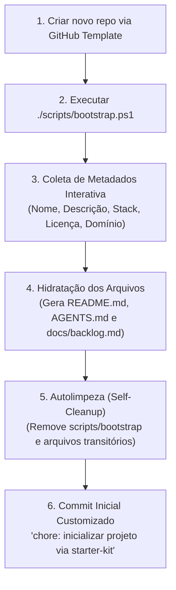

# 🏗️ Etapa 2: Desenho da Estrutura Oficial do `project-starter-kit`

Para resolver definitivamente o problema do "template cego" do GitHub e garantir que qualquer novo projeto inicie com **zero atrito**, **higiene técnica impecável** e **governança de IA ativa desde o primeiro minuto**, desenhei a arquitetura oficial do **`project-starter-kit`**.

---

## 🎯 1. Os 3 Problemas Reais que o Starter Kit Resolve

1. **A Fricção do "Clone Cego":** Ao usar _Use this template_ no GitHub, o `README.md` copiado fala do próprio template, contém links mortos e traz arquivos de meta-documentação que poluem o novo projeto.
2. **A Fragmentação das Ferramentas de IA:** O desenvolvedor precisa configurar regras no `AGENTS.md`, mas também no `.cursorrules`, no `.github/copilot-instructions.md` e no `.windsurfrules`. O starter kit unifica tudo em **uma única fonte da verdade**.
3. **A Ausência de Governança no Dia Zero:** Frequentemente, projetos começam apenas com código solto e deixam testes, specs, CI e blindagem de segurança para "depois". O starter kit estabelece o **Épico 0 (Fundação)** já pré-atendido.

---

## 📁 2. Árvore Canônica de Diretórios do `project-starter-kit`

```text
project-starter-kit/
│
├── .github/
│   ├── workflows/
│   │   ├── ci.yml                     # Pipeline base multi-stack (Lint, Test, Dependency-Check)
│   │   └── gitleaks.yml               # Verificação preventiva de vazamento de segredos
│   ├── ISSUE_TEMPLATE/
│   │   ├── feature_spec.md            # Criação de issue vinculada a uma SPEC
│   │   └── bug_report.md              # Report de bug orientado a evidências
│   └── copilot-instructions.md        # Ponte para o GitHub Copilot ler o AGENTS.md
│
├── .vscode/
│   ├── extensions.json                # Extensões recomendadas (Linter, GitLens, Test Runner)
│   └── settings.json                  # Padronização UTF-8, LF, formatação on-save e ruler
│
├── docs/
│   ├── backlog.md                     # Backlog vivo (Docs-as-Code com Épicos 0 a N)
│   ├── glossario.md                   # Vocabulário ubíquo e termos de domínio
│   ├── adrs/                          # Registros de decisões de arquitetura (ADR-0001+)
│   ├── specs/                         # Especificações de funcionalidades (SPEC-0001+)
│   ├── analyses-ai/                   # Histórico de revisões multi-IA (001+, -concluded)
│   └── templates/                     # Biblioteca de templates refinados
│       ├── AGENTS.md                  # Template universal de regras operacionais de IA
│       ├── SPEC.md                    # Template de especificação com fatias verticais e DoD
│       ├── ADR.md                     # Template de decisão arquitetural com gatilhos
│       ├── BACKLOG.md                 # Template de roadmap Docs-as-Code
│       ├── ANALYSIS-AI.md             # Template de auditoria de código por IA
│       └── README-PROJECT.md          # Template de README de produto
│
├── scripts/
│   ├── bootstrap.ps1                  # Script interativo de inicialização (Windows/PowerShell)
│   └── bootstrap.sh                   # Script interativo de inicialização (Linux/macOS)
│
├── .editorconfig                      # Padronização universal de encoding, tabs e quebra de linha
├── .env.example                       # Modelo de variáveis de ambiente sem dados sensíveis
├── .gitignore                         # Blindagem multi-linguagem (build, temporários, segredos, chaves)
├── .gitleaks.toml                     # Regras de detecção de segredos
├── .gitleaksignore                    # Exceções auditadas de testes/documentação
├── AGENTS.md                          # Contrato de governança ativo para os agentes de IA
├── LICENSE                            # Licença de código aberto (padrão MIT)
└── README.md                          # Visão geral do repositório
```

---

## ⚡ 3. O Mecanismo de Inicialização Inteligente (`scripts/bootstrap`)

Para eliminar o trabalho manual de "caçar placeholders", o repositório template incluirá um script de **hidratação e inicialização de projeto** (`bootstrap.ps1` e `bootstrap.sh`).

### Como funciona o fluxo de arranque:



### O que o script de Bootstrap faz automaticamente:

1. **Pergunta interativamente:**
   - Nome do novo projeto (ex: `payment-gateway-api`).
   - Descrição curta do valor do software.
   - Stack principal (Java / Spring, Node / TypeScript, Python / FastAPI, .NET, Go).
   - Organização/Usuário GitHub.
2. **Gera os arquivos finais:**
   - Converte `docs/templates/README-PROJECT.md` no `README.md` raiz, já com o nome, stack e comandos corretos.
   - Converte `docs/templates/AGENTS.md` no `AGENTS.md` da raiz, injetando os comandos de build/teste da stack escolhida.
   - Gera o `docs/backlog.md` com o Épico 0 marcado como concluído e o Épico 1 pronto para preenchimento.
3. **Autolimpeza (_Self-Cleanup_):**
   - Pergunta: _"Deseja remover os scripts de bootstrap e arquivos temporários do template?"_
   - Se sim, remove a pasta `scripts/` e deixa o repositório 100% limpo, como se tivesse sido criado sob medida.

---

## 🌉 4. Governança Multi-Ferramenta (Ponte Universal de IA)

Para que qualquer ferramenta de IA respeite as mesmas regras sem duplicação de texto:

- **Antigravity / Claude Code:** Lê nativamente o [AGENTS.md](file:///e:/Projects/GitHub/heviane/nfse-nacional-api/AGENTS.md) da raiz.
- **GitHub Copilot (`.github/copilot-instructions.md`):**

  ```markdown
  # GitHub Copilot Instructions

  Consulte e siga estritamente todas as diretrizes operacionais, regras de ouro,
  padrões de commit e comandos de teste definidos no arquivo AGENTS.md na raiz deste repositório.
  ```

- **Cursor (`.cursorrules`):**

  ```markdown
  Always follow the guidelines, minimal diff principles, and commands specified in AGENTS.md.
  ```

- **Windsurf (`.windsurfrules`):**

  ```markdown
  Refer to and strictly obey the operational guidelines declared in AGENTS.md.
  ```

> Dessa forma, você edita apenas o `AGENTS.md` e **todas as IAs do mercado operam sob o mesmo contrato**.

---

## 🛡️ 5. Blindagem de Higiene, Segurança & CI

O starter kit já nasce com as seguintes proteções ativas:

1. **`.editorconfig` Multi-Stack:**
   - Garante `charset = utf-8`, `end_of_line = lf`, `insert_final_newline = true` e `trim_trailing_whitespace = true`.
   - Indentação padrão de 4 espaços para Java/Python/.NET e 2 espaços para JS/TS/JSON/YAML/Markdown.
2. **`.gitignore` Defensivo:**
   - Blindagem universal de certificados e chaves (`*.p12`, `*.pfx`, `*.pem`, `*.key`, `*.jks`).
   - Bloqueio de arquivos locais de ambiente (`.env`, `.env.local`, `application-local.properties`).
   - Bloqueio de artefatos temporários de build de Java, Node, Python, .NET e Docker.
3. **Workflow de CI Base (`.github/workflows/ci.yml`):**
   - Job 1: **Gitleaks** (bloqueia o commit caso haja qualquer secret ou chave privada).
   - Job 2: **Lint & Build** (compila e roda os testes automatizados da stack escolhida).
   - Job 3: **Dependency Audit** (OWASP Dependency-Check ou ferramenta nativa da stack).

---

## 🚀 6. Como esse desenho se conecta com o seu repositório atual

Podemos documentar essa estrutura oficial dentro de `docs/dev/analyses-dev-com-ia/` como a referência definitiva para quando você criar o repositório `project-starter-kit` no seu GitHub.

Dessa forma, o seu portfólio passa a ter:

1. **`nfse-nacional-api`:** A implementação de referência, complexa e de produção real (middleware fiscal, criptografia, XML, SOAP/REST).
2. **`project-starter-kit`:** A fábrica/plataforma padronizada para criar novos projetos com a mesma maturidade técnica em minutos.

Deseja que eu crie um documento consolidando essa especificação do Starter Kit em `docs/dev/analyses-dev-com-ia/` para registrarmos essa etapa, e em seguida avancemos para a **Etapa 3 (Playbook Metodológico de Condução do Agente)**?
