# 🌐 Panorama: Engenharia de Software Assistida por IA

```mermaid
flowchart LR
    subgraph G["1. Governança & Contratos"]
        A["AGENTS.md<br>(Regras Invioláveis)"]
        B["Human-in-the-Loop<br>(Aprovação Explícita)"]
    end

    subgraph D["2. Docs-as-Code & SDD"]
        C["BACKLOG.md<br>(Épicos e Fatias)"]
        D1["SPEC.md<br>(Critérios de Aceite Gherkin)"]
        E["ADR.md<br>(Decisões Arquiteturais)"]
    end

    subgraph E1["3. Execução Técnica & TDD"]
        F["Walking Skeleton"]
        G1["TDD / Minimal Diff"]
        H["Higiene & Testes Automatizados"]
    end

    subgraph R["4. Revisão & Multi-AI Review"]
        I["Análises Cruzadas<br>(Claude / ChatGPT / Antigravity)"]
        J["Conclusão Baseada em Evidências"]
    end

    G --> D --> E1 --> R
```



---

## 🏛️ 1. As 5 Dimensões do Modelo Atual

### Dimensão A: Governança do Agente & Contrato Operacional (`AGENTS.md`)

- **Regras de Ouro Invioláveis:** Estabelecer limites claros como _Human-in-the-Loop_ (aprovação prévia antes de editar ou comitar), _Anti-Lazy Code_ (código completo, sem reticências), _Minimal Diff_ e _Conclusão Baseada em Evidências_ (suíte verde).
- **Segurança e Privacidade Nativa (LGPD & Secrets):** Isolamento total de certificados em memória, proibição de dados reais de clientes em fixtures e blindagem contra testes diretos em produção.
- **Padronização Semântica:** Commits no padrão Conventional Commits vinculados a issues ou tarefas do backlog.

### Dimensão B: Metodologia Orientada a Especificação (Docs-as-Code & SDD)

- **Spec antes do Código (`SPEC.md`):** O agente nunca começa a codificar "no escuro"; ele atua sobre requisitos funcionais (RF), não-funcionais (RNF) e critérios de aceite em formato Gherkin.
- **Memória Arquitetural Imutável (`ADR.md`):** Registrar decisões de arquitetura (Java 17, Spring Boot, Hexagonal/ACL, Maven) impede que a IA, em sessões futuras com contexto renovado, tente rediscutir ou refatorar pilares estruturais já consolidados.
- **Backlog e Roadmap no Git (`docs/backlog.md`):** Visão ágil com épicos numerados, fatias verticais, matriz de status/prioridade e rastreabilidade direta com o GitHub Projects.
- **Alinhamento Semântico e Conceitual:** Glossários técnicos (`glossario-engenharia.md` e `glossario-nfse.md`) que unificam os termos de negócio e tecnologia, eliminando ambiguidades conceituais nas conversas com o modelo.

### Dimensão C: Ciclo de Desenvolvimento Iterativo & Feedback Rápido (TDD)

- **Feedback em Loops Curtos:** Testes unitários e de integração (`./mvnw test`) executados a cada incremento cirúrgico.
- **Harness de Segurança:** A IA ganha autonomia segura porque qualquer regressão é detectada imediatamente pelo compilador e pela suíte de testes automatizados.
- **Tratamento de Fricções:** Separação entre falhas reais de domínio e problemas de infraestrutura/ambiente.

### Dimensão D: Auditoria Contínua & Multi-Model Review (`analyses-ai/`)

- **Perspectiva Multi-IA:** O uso de diferentes modelos (Antigravity, Claude, ChatGPT) como revisores de código e arquitetura trouxe pontos de vista complementares:
  - Um modelo com foco cirúrgico em vulnerabilidades de protocolo, XML e threads.
  - Outro com visão holística de produto, escalabilidade comercial, multi-tenancy e roadmap.
- **Ciclo de Fechamento Formal:** As análises não ficaram como notas esquecidas; foram organizadas numericamente (`001` a `004`), divididas em planos de ação e formalizadas com seus respectivos arquivos de conclusão (`-concluded.md`).

### Dimensão E: Infraestrutura & Automação de Qualidade (CI/CD)

- **Gitleaks:** Bloqueio preventivo de credenciais e chaves.
- **OWASP Dependency-Check:** Inspeção contínua de vulnerabilidades de dependências.
- **Reprodutibilidade:** `.editorconfig`, configurações de editor (`.vscode`), `.gitignore` específico e Maven Wrapper garantindo paridade entre o desenvolvedor humano, a máquina local e a esteira de CI.

---

## ⚖️ 2. Pontos Fortes vs. Gargalos e Oportunidades de Melhoria

| Aspecto                   | O que funcionou com excelência ✅                                                              | Fricção / Oportunidade para Próximos Projetos ⚠️                                                                                                                           |
| :------------------------ | :--------------------------------------------------------------------------------------------- | :------------------------------------------------------------------------------------------------------------------------------------------------------------------------- |
| **Arranque do Projeto**   | O Walking Skeleton permitiu ter um endpoint funcional e testes verdes no primeiro dia.         | **Setup inicial manual:** Copiar templates, renomear arquivos e ajustar configurações de stack ainda exige esforço repetitivo.                                             |
| **Comunicação com IA**    | O `AGENTS.md` reduziu drasticamente alucinações e evitou reescritas destrutivas de arquivos.   | **Multi-ferramentas:** Diferentes ferramentas de IA leem arquivos diferentes (`AGENTS.md`, `.cursorrules`, `copilot-instructions.md`). Falta uma sincronização automática. |
| **Documentação Técnica**  | Specs e ADRs mantiveram o design limpo e permitiram que a IA entendesse os limites do domínio. | **Sincronização Código vs Spec:** Conforme o código amadurece, pequenos detalhes da spec podem desatualizar se não houver um checklist de fechamento.                      |
| **Templates**             | Os templates de `SPEC.md`, `ADR.md` e `BACKLOG.md` deram consistência editorial e técnica.     | **Templates estáticos:** Faltam placeholders padronizados ou automação para scaffolding de novos módulos/épicos.                                                           |
| **Pipeline de Qualidade** | Testes automatizados e CI rápido permitiram commits frequentes com segurança.                  | **Falta de Continuous Deployment (CD):** O processo de deploy na hospedagem ainda é manual.                                                                                |

---

## 🎯 3. Eixos Estratégicos para Estruturação do Futuro Toolkit

Para transformar essas lições em um **ecossistema reutilizável para qualquer novo projeto**, sugiro organizarmos nossa atuação nas seguintes frentes:

```text
                      ┌──────────────────────────────────────────────┐
                      │   AI-ENGINEERING REUSABLE PLAYBOOK & KIT    │
                      └──────────────────────┬───────────────────────┘
                                             │
      ┌──────────────────────┬───────────────┴──────────────┬──────────────────────┐
      ▼                      ▼                              ▼                      ▼
[EIXO 1]              [EIXO 2]                       [EIXO 3]               [EIXO 4]
Governança Unificada  Templates & Scaffolding        Metodologia & Fluxo    Higiene & CI/CD
• AGENTS.md universal • Starter Kit de Repositórios  • Ciclo SDD + TDD      • Workflow padrão de CI
• Matriz de regras    • Templates de Docs maduros    • Multi-AI Review      • Segurança & Gitleaks
• Adaptador de IDEs   • CLI/Script gerador           • Fechamento e Evidência• Checklist de Release
```

1. **Eixo 1 — Governança Unificada de Agentes:**
   - Criar um `AGENTS.md` "Master/Universal" desacoplado de linguagem, contendo as regras invioláveis de engenharia, com uma seção plugável para regras específicas de stack (Java/Spring, Node/TypeScript, Python, etc.).
   - Definir a estratégia para compatibilizar Antigravity, GitHub Copilot, Claude Code e Cursor a partir de uma única fonte da verdade.

2. **Eixo 2 — O "Project Starter Kit" & Templates Evoluídos:**
   - Consolidar o repositório template (`project-starter-kit`) com a estrutura de pastas ideal, `.editorconfig`, CI padrão e os templates maduros de:
     - `README-PROJECT.md` (com badges, arquitetura Mermaid, quickstart).
     - `SPEC.md` (com RF, RNF, Gherkin e plano de fatias verticais).
     - `ADR.md` (com contexto, decisão, consequências e alternativas consideradas).
     - `BACKLOG.md` (com épicos numerados, banco de ideias e matriz de prioridades).
     - `ANALYSIS-AI.md` (template padronizado para análises de arquitetura/código feitas por IAs).

3. **Eixo 3 — O Playbook Metodológico de Pair Programming Agêntico:**
   - Sistematizar as fases de um ciclo de entrega com IA:
     1. _Fase de Alinhamento e Spec:_ Criar/refinar a spec antes de codificar.
     2. _Fase de Implementação:_ Test-First ou Walking Skeleton com commits atômicos.
     3. _Fase de Auditoria:_ Rodar análises estáticas/cruzadas de modelos.
     4. _Fase de Conclusão:_ Evidência de testes + Documentação de conclusão.

4. **Eixo 4 — Automação de Scaffolding (Script / CLI de Inicialização):**
   - Avaliar a criação de uma rotina simples (ex: script Bash/PowerShell ou gerador) que ao criar um novo projeto já pergunte o nome, stack, descrição e gere o repositório customizado com todos os templates preenchidos, sem arquivos "lixo" do template.

---

### 💬 Como você prefere direcionar a nossa análise?

Podemos iniciar por qualquer uma das frentes:

1. **Refinamento dos Templates (`SPEC`, `ADR`, `BACKLOG`, `AGENTS.md` e novo template de Análise AI)**;
2. **Desenho da Estrutura Oficial do `project-starter-kit` (arquivos, pastas, governança)**;
3. **Mapeamento do Fluxo Operacional / Playbook passo a passo (como conduzir o agente do zero até a produção)**.
