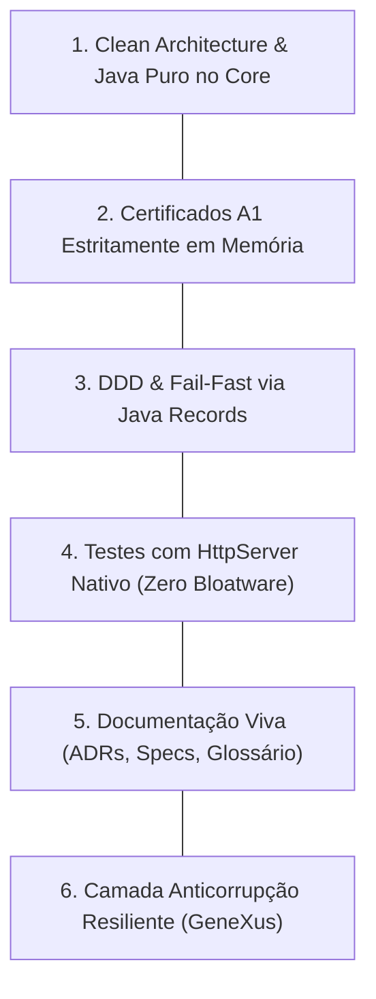

# Pilares Arquiteturais, Decisões de Design & Pontos Fortes

> **Documento:** `docs/dev/pilares-arquitetura-e-boas-praticas.md`  
> **Objetivo:** Registrar formalmente as decisões de engenharia, princípios arquiteturais e práticas de qualidade que constituem os pilares fundamentais do projeto **`nfse-nacional-api`**, servindo como guia de preservação para desenvolvedores e agentes de IA.  
> **Status:** `Ativo / Documento de Referência Arquitetural`  
> **Classificação:** Engenharia de Software / Arquitetura Hexagonal & Segurança Fiscal  

---

## 🏛️ Visão Geral

O projeto **`nfse-nacional-api`** foi concebido sob requisitos severos:
1. **Missão Crítica:** Interrupções na emissão de NFS-e paralisam o faturamento da empresa.
2. **Segurança Tributária:** O manuseio de Certificados Digitais ICP-Brasil A1 e dados fiscais exige isolamento absoluto.
3. **Restrição de Negócio:** Operar como middleware de transição transparente para ERPs legados (como GeneXus 18), exigindo **zero alterações** no sistema cliente.

Para atingir esses objetivos com excelência, o projeto consolidou **6 pilares arquiteturais fundamentais** que devem ser preservados em qualquer ciclo de manutenção ou evolução.

---

## 🛡️ Os 6 Pilares Arquiteturais (Manter & Preservar)

---

### 1. Separação Clara Core / Adaptadores e Injeção Centralizada
* **Implementação:**
  - O Core Fiscal (`br.com.heviane.nfse.core.*`) foi desenvolvido em **Java 17 puro**, sem importar nenhuma anotação de framework (como `@Service`, `@Component` ou `@Autowired` do Spring Boot).
  - Todas as dependências externas são definidas como Portas de Entrada (`ports.in`) e Portas de Saída (`ports.out`).
  - A classe [`NfseCoreConfiguration`](file:///e:/Projects/GitHub/heviane/nfse-nacional-api/src/main/java/br/com/heviane/nfse/config/NfseCoreConfiguration.java) atua como a única central de instanciação e fiação de dependências da Arquitetura Hexagonal.
* **Benefícios:**
  - **Testabilidade Ultrarrápida:** Testes unitários do Core rodam de forma determinística em milissegundos, sem overhead de inicialização de contexto de framework.
  - **Independência Tecnológica:** O Core pode ser reutilizado em CLI, funções Serverless (AWS Lambda / Google Cloud Run), Quarkus ou microsserviços sem alterar uma única linha de regra de negócio.

---

### 2. Segurança Fiscal & Isolamento de Certificados A1
* **Implementação:**
  - O Certificado Digital ICP-Brasil A1 (`.pfx` ou `.p12`) é manipulado **estritamente em memória** através de `KeyStore` instanciada em tempo de execução via [`CertificadoA1`](file:///e:/Projects/GitHub/heviane/nfse-nacional-api/src/main/java/br/com/heviane/nfse/core/domain/CertificadoA1.java).
  - Chaves privadas e senhas em texto puro **NUNCA** são salvas no disco rígido do servidor e nunca são logadas.
  - O arquivo [`.gitignore`](file:///e:/Projects/GitHub/heviane/nfse-nacional-api/.gitignore) aplica bloqueio multinível para todas as extensões criptográficas (`*.pfx`, `*.p12`, `*.jks`, `*.keystore`, `*.key`, `*.pem`) e scripts de execução local (`run-local.ps1`, `test-homologacao-sefin.ps1`).
  - Integração contínua com escaneamento de credenciais (**Gitleaks**) e verificação de vulnerabilidades de dependências (**OWASP Dependency-Check**).
* **Benefícios:**
  - Risco zero de vazamento de certificados digitais ou comprometimento da procuração eletrônica do cliente.
  - Conformidade estrita com o sigilo fiscal e as normas da LGPD.

---

### 3. Domain-Driven Design (DDD) & *Fail-Fast* com Java Records
* **Implementação:**
  - Todas as entidades de entrada e valor são representadas por Java Records imutáveis ([`RequisicaoEnvioDps`](file:///e:/Projects/GitHub/heviane/nfse-nacional-api/src/main/java/br/com/heviane/nfse/core/domain/RequisicaoEnvioDps.java), [`RequisicaoCancelamentoDps`](file:///e:/Projects/GitHub/heviane/nfse-nacional-api/src/main/java/br/com/heviane/nfse/core/domain/RequisicaoCancelamentoDps.java), [`RegistroEmissaoAuditoria`](file:///e:/Projects/GitHub/heviane/nfse-nacional-api/src/main/java/br/com/heviane/nfse/adapters/in/observability/RegistroEmissaoAuditoria.java)).
  - As validações de formato (tamanho de Chave de 50 dígitos, formato de CNPJ de 14 dígitos, código de motivo numérico) são executadas diretamente no **construtor compacto**.
* **Benefícios:**
  - **Invariantes Garantidas:** É matematicamente impossível instanciar um objeto em estado inválido na aplicação.
  - **Detecção Imediata (*Fail-Fast*):** Falhas de dados informados pelo cliente são interceptadas logo na entrada, impedindo o desperdício de processamento criptográfico ou chamadas desnecessárias de rede com mTLS.

---

### 4. Dublês de Teste com `HttpServer` Nativo da JVM (Zero Bloatware)
* **Implementação:**
  - O adaptador do Sefin ([`SefinClientAdapterTest`](file:///e:/Projects/GitHub/heviane/nfse-nacional-api/src/test/java/br/com/heviane/nfse/adapters/out/sefin/SefinClientAdapterTest.java)) é testado contra um servidor HTTP local instanciado via classe padrão da biblioteca padrão Java: `com.sun.net.httpserver.HttpServer`.
  - Portas dinâmicas efêmeras são alocadas e destruídas no ciclo de vida de cada teste.
* **Benefícios:**
  - **Parcimônia de Dependências:** Elimina a necessidade de bibliotecas pesadas de mock (como WireMock ou MockServer), evitando conflitos clássicos de versões entre Jetty, Tomcat e Servlet API no Spring Boot 3.3.
  - **Execução Leve:** A suíte com mais de 170 testes executa em menos de 1 minuto em qualquer máquina ou pipeline de CI/CD.

---

### 5. Documentação Viva como Ativo de Engenharia
* **Implementação:**
  - O repositório mantém documentação sincronizada em tempo real com o código-fonte:
    - **ADRs (`docs/adrs/`):** Histórico de decisões arquiteturais com alternativas consideradas e justificativas técnicas (ex: rejeição de JAXB em favor de DOM puro no Java 17).
    - **Specs (`docs/specs/`):** Especificações formais orientadas a testes (Spec-Driven Development).
    - **Glossário (`docs/glossary.md`):** Dicionário de terminologias da Receita Federal, ABRASF e GeneXus.
    - **Manuais de Operação (`docs/dev/` e `docs/clients/`):** Procedimentos de deploy, rollback, roteiro de homologação e resolução de problemas.
* **Benefícios:**
  - Eliminação da "arqueologia de código".
  - Qualquer novo engenheiro de software ou equipe de suporte do cliente consegue entender, manter e operar a aplicação em questão de horas.

---

### 6. Camada Anticorrupção Resiliente para ERPs Legados (GeneXus)
* **Implementação:**
  - O controlador de compatibilidade SOAP ([`LegacySoapController`](file:///e:/Projects/GitHub/heviane/nfse-nacional-api/src/main/java/br/com/heviane/nfse/adapters/in/legacy/LegacySoapController.java)) atua como emulador da antiga prefeitura (SIL Tecnologia / Vila Velha - ES).
  - Em situações de erro de validação ou rejeição fiscal, a API **NÃO retorna** `HTTP 500` com `<soap:Fault>`. Em vez disso, retorna `HTTP 200 OK` estruturado com o envelope padrão contendo o bloco `<MensagemRetorno><Codigo>...</Codigo><Mensagem>...</Mensagem></MensagemRetorno>`.
* **Benefícios:**
  - Clientes gerados por GeneXus 18, Win32, .NET ou Visual FoxPro abortam imediatamente com exceção de runtime não tratada ao receber `HTTP 500`.
  - Ao receber `HTTP 200` com mensagens amigáveis de retorno, o ERP exibe a mensagem de rejeição diretamente na tela para o usuário do faturamento, sem interrupção de sistema.
  - Cumprimento rigoroso do compromisso comercial: **zero alterações de código no ERP do cliente**.

---

## 📌 Diretrizes de Sustentação para Agentes e Desenvolvedores

Ao implementar novas funcionalidades, correções ou refatorações neste repositório:
1. **Nunca quebre o isolamento do Core:** Não adicione anotações do Spring dentro de `core/`.
2. **Nunca persista certificados ou senhas no disco:** Mantenha a guarda de credenciais em variáveis de ambiente e manipulação em memória.
3. **Preserve os contratos de resposta legados:** Qualquer alteração na camada SOAP deve ser validada contra os testes de compatibilidade do GeneXus.
4. **Mantenha os testes automatizados íntegros:** Nenhum código novo deve ser mesclado sem cobertura de testes unitários ou de integração correspondente.
