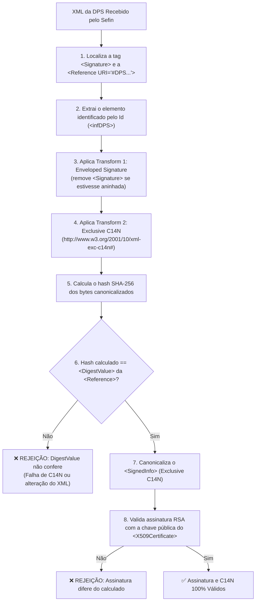

# Roteiro Operacional de Homologação no Sefin Nacional (Produção Restrita)

> **Documento:** `docs/dev/roteiro-homologacao-sefin-nacional.md`  
> **Objetivo:** Roteiro prático para guiar a desenvolvedora e o cliente na realização da primeira emissão, consulta e cancelamento reais contra o Ambiente Nacional da NFS-e (Sefin Nacional / ADN), com ênfase na validação de canonicalização (C14N), mTLS e integridade da assinatura digital W3C XML-DSig.  
> **Status:** `Ativo / Guia de Implantação Técnica`  
> **Versão dos Schemas:** `v1.00` e `v1.01`  

---

## 1. 🏛️ Contexto, Arquitetura & Endpoints Oficiais

O ecossistema do Sistema Nacional da NFS-e (Sefin Nacional / Ambiente de Dados Nacional - ADN) é operado em nuvem pelo Serpro / Receita Federal do Brasil. Para garantir a segurança tributária e jurídica, todas as comunicações são protegidas por:

1. **Camada de Transporte (mTLS):** Autenticação mútua TLS 1.2+ onde o cliente apresenta seu Certificado ICP-Brasil A1 e valida a autoridade certificadora governamental do Sefin através da cadeia de confiança (TrustStore).
2. **Camada de Aplicação (W3C XML-DSig):** O conteúdo da declaração (`<infDPS>` para emissão e `<infPedReg>` para cancelamento) é assinado digitalmente pelo emissor com seu certificado A1 utilizando RSA-SHA256 e Canonicalização Exclusiva (C14N).

### 🌐 Endpoints Oficiais do Sefin Nacional

| Ambiente | Base URL Sefin | Propósito |
| :--- | :--- | :--- |
| **Homologação (Produção Restrita)** | `https://sefin.hom.nfse.gov.br` | Testes de integração, validação de regras fiscais e schemas sem validade tributária real. |
| **Produção Oficial** | `https://sefin.nfse.gov.br` | Emissão oficial de NFS-e com efeitos tributários plenos. |

> [!IMPORTANT]
> **Regra de Ouro (AGENTS.md - Regra 10):**
> Testes automatizados ou manuais conduzidos durante a fase de desenvolvimento e pré-implantação DEVEM ser apontados exclusivamente para o ambiente de **HOMOLOGAÇÃO** (`NFSE_ENVIRONMENT=HOMOLOGACAO`). É terminantemente proibido testar contra a URL de Produção sem autorização prévia formal da desenvolvedora.

---

## 2. 🔐 O Ponto Crítico da Assinatura: Canonicalização (C14N) e DigestValue

A causa mais frequente de rejeição em servidores de notas fiscais eletrônicas da Receita Federal (como o erro *"Rejeição: Assinatura difere do calculado"* ou *"DigestValue não confere"*) decorre de pequenas discrepâncias na **canonicalização XML**.

### ⚙️ Como o Sefin Nacional valida a assinatura da DPS:



### 🎯 Garantias Implementadas no Assinador (`AssinadorDpsService`):
1. **Ordem Estrita de Transformações:**
   - 1º: `http://www.w3.org/2000/09/xmldsig#enveloped-signature`
   - 2º: `http://www.w3.org/2001/10/xml-exc-c14n#`
2. **Exclusão de Namespaces Não Utilizados:** O algoritmo de Canonicalização Exclusiva (`xml-exc-c14n#`) impede que declarações de namespace do nó pai `<DPS>` poluam os bytes do elemento filho `<infDPS>`, garantindo que o digest calculado em memória no Java coincida perfeitamente com o digest recalculado no servidor do Serpro.
3. **Serialização Neutra:** O XML final é serializado sem indentação artificial (`INDENT=no`) e com codificação `UTF-8` estrita, evitando quebras de linha do Windows (`\r\n`) que poderiam invalidar hashes.

---

## 3. 📋 Checklist Operacional de Homologação (Passo a Passo)

### Passo 1: Preparação do Ambiente e Credenciais
- [ ] Obter o Certificado ICP-Brasil A1 (`.pfx` ou `.p12`) emitido para o CNPJ habilitado no ambiente de homologação do Sefin Nacional.
- [ ] Confirmar a senha do certificado.
- [ ] Certificar-se de que a variável de ambiente está apontando para homologação:
  ```bash
  export NFSE_ENVIRONMENT=HOMOLOGACAO
  ```
- [ ] No Tomcat / Linux, configurar o caminho absoluto do certificado no `bin/setenv.sh`:
  ```bash
  export NFSE_CERT_PATH=/opt/certs/certificado_homologacao.pfx
  export NFSE_CERT_PASSWORD=sua_senha_secreta
  ```

### Passo 2: Verificação Prévia de Saúde (*Pre-Flight Smoke Test*)
Inicie a aplicação e consulte o endpoint de integridade do Actuator:
```bash
curl -s http://localhost:8080/actuator/health
```
**Resposta esperada:**
```json
{"status":"UP"}
```

### Passo 3: Emissão Real da Primeira DPS de Homologação

#### Opção A: Via API REST (`POST /api/v1/dps`)
Envie a requisição contendo o XML da DPS a ser validada, assinada e transmitida:
```bash
curl -X POST http://localhost:8080/api/v1/dps \
  -H "Content-Type: application/json" \
  -d '{
    "xmlDps": "<DPS xmlns=\"http://www.sped.fazenda.gov.br/nfse\" versao=\"1.00\"><infDPS Id=\"DPS32052002601000000000019100001000000000000001\"><tpAmb>2</tpAmb><dhEmi>2026-11-09T12:00:00-03:00</dhEmi><verAplic>NfseApi_v1.0</verAplic><dCompet>2026-11-09</dCompet><prest><CNPJ>00000000000191</CNPJ><regTrib><opSimpNac>1</opSimpNac><regApTribSN>1</regApTribSN></regTrib></prest><toma><CNPJ>00000000000191</CNPJ><xNome>TOMADOR DE TESTE HOMOLOGACAO</xNome><ender><endNac><cMun>3205200</cMun><CEP>29100000</CEP></endNac><xLgr>RUA DE TESTE</xLgr><nro>100</nro><xBairro>CENTRO</xBairro></ender></toma><serv><locPrest><cLocPrestacao>3205200</cLocPrestacao></locPrest><cServ><cTribNac>010701</cTribNac><xDescServ>SERVICO DE DESENVOLVIMENTO DE SOFTWARE HOMOLOGACAO</xDescServ></cServ><valores><vServPrest><vServ>10.00</vServ></vServPrest><trib><tribMun><tribISSQN>1</tribISSQN><cLocIncid>3205200</cLocIncid><vBC>10.00</vBC><pAliq>2.00</pAliq><vISSQN>0.20</vISSQN><tpRetISSQN>1</tpRetISSQN></tribMun><tribFed><piscofins><tpRetPisCofins>2</tpRetPisCofins></piscofins></tribFed></trib></valores></serv></infDPS></DPS>",
    "ambiente": "HOMOLOGACAO"
  }'
```
> *(Nota de Autenticação: Caso a proteção por API Key esteja ativada no middleware, adicione o cabeçalho correspondente na chamada, por exemplo `-H "X-API-Key: $NFSE_API_KEY"`).*

#### Opção B: Via Emulador SOAP GeneXus (`POST /prefeitura/notafiscal/nfse.asmx`)
Dispare a emissão pelo próprio ERP GeneXus ou via `curl` simulando o envelope SOAP legado:
```bash
curl -X POST http://localhost:8080/prefeitura/notafiscal/nfse.asmx \
  -H "Content-Type: text/xml; charset=utf-8" \
  -H "SOAPAction: \"http://www.abrasf.org.br/nfse.xsd/GerarNfse\"" \
  --data-binary @scripts/samples/envelope-soap-envio-dps.xml
```

### Passo 4: Avaliação do Retorno do Sefin Nacional

1. **Autorização Imediata (Síncrona - Código 100):**
   - Retorno HTTP 200 com a **Chave de Acesso de 50 dígitos** (`chaveAcesso`) e o número do protocolo.
   - O log de auditoria registrará:
     ```text
     AUDIT-FISCAL: operacao=EMISSAO | origem=REST | statusFiscal=100 | statusHttp=200 | chave=32... | protocolo=...
     ```
2. **Processamento Assíncrono (Código 105):**
   - Caso o Sefin receba a DPS em processamento assíncrono, o middleware executa polling transparente de até 3 tentativas. Se persistir pendente, retorna o status 105 e o protocolo de recebimento para conciliação posterior.
3. **Persistência Durável Automática:**
   - O middleware grava automaticamente a relação `idDps` &rarr; `chaveAcesso` no arquivo `logs/registro-emissoes.jsonl`.
   - Se a conexão cair antes de o ERP receber o retorno, basta consultar:
     ```bash
     curl -i http://localhost:8080/api/v1/nfse/historico-local/DPS32052002601000000000019100001000000000000001
     ```

### Passo 5: Consulta da NFS-e Emitida pela Chave de Acesso
Valide se a NFS-e autorizada pode ser consultada e recuperada do repositório nacional do Sefin:
```bash
curl -X GET "http://localhost:8080/api/v1/nfse/32052002601000000000019100001000000000000001123456?ambiente=HOMOLOGACAO"
```
**Resposta esperada:**
- `localizada`: `true`
- `codigoStatus`: `100`
- `xmlNfse`: XML descompactado da NFS-e oficial emitida pela Receita Federal contendo o bloco `<infNFSe>`.

### Passo 6: Teste de Cancelamento Fiscal (Evento 101101)
Dispare o evento de cancelamento da NFS-e autorizada no teste anterior:
```bash
curl -X POST "http://localhost:8080/api/v1/nfse/32052002601000000000019100001000000000000001123456/cancelar" \
  -H "Content-Type: application/json" \
  -d '{
    "codigoMotivo": "1",
    "motivo": "Cancelamento de teste operacional no ambiente de homologacao",
    "cnpjAutor": "00000000000191",
    "ambiente": "HOMOLOGACAO"
  }'
```
**Resposta esperada:**
- `statusHttp`: `200`
- `codigoStatus`: `100` ou código oficial do Sefin de homologação do evento de cancelamento.

---

## 4. 🛠️ Matriz de Diagnóstico de Rejeições do Sefin Nacional

| Erro / Código Sefin | Causa Raiz Típica | Ação Corretiva |
| :--- | :--- | :--- |
| **Rejeição: Falha no Schema XML** | Tag ausente, ordem de elementos incorreta ou tamanho de campo fora do padrão XSD. | Inspecione os erros detalhados retornados no `detalhesErros`. A validação pré-transmissão do middleware (`ValidadorSchemaService`) bloqueia 99% desses casos antes do envio. |
| **Rejeição: Assinatura difere do calculado** *(DigestValue divergente)* | Alteração no texto do XML após a geração do digest, problemas de quebra de linha (`\r\n`), ou canonicalização incorreta de namespaces. | O `AssinadorDpsService` implementa C14N Exclusive (`xml-exc-c14n#`). Certifique-se de que nenhum proxy intermediário ou software WAF esteja reformatando ou re-indentando o payload XML. |
| **Rejeição: Certificado do transmissor inválido / revogado** | Certificado vencido, revogado ou cadeia intermediária ausente na comunicação mTLS. | Verifique a data de validade do `.pfx` e instale o TrustStore com a cadeia ICP-Brasil completa (`NFSE_TRUSTSTORE_PATH`). |
| **Rejeição: DPS já recebida / Chave já existente** | O `Id` da DPS (`infDPS Id="..."`) já foi emitido anteriormente na base do Sefin. | Gere um novo `Id` para a DPS de teste (alterando a numeração sequencial no XML). Caso o ERP tenha perdido a resposta da DPS anterior, utilize `GET /api/v1/nfse/historico-local/{idDps}` para recuperar a chave sem emitir duplicidade. |
| **Rejeição: CNPJ do emitente não credenciado** | O CNPJ do certificado não possui habilitação no ambiente de homologação do Sefin Nacional. | Solicite ao cliente ou à contabilidade o credenciamento do CNPJ de homologação no portal do Sefin Nacional / Receita Federal. |
| **HTTP 502 / Gateway Timeout** | Instabilidade passageira ou lentidão de rede nos servidores da Receita Federal. | O middleware possui mecanismo transparente de recuperação de timeout que consulta a DPS via `GET /dps/{id}` para evitar emissão duplicada. |

---

## 5. 🎯 Conclusão e Critérios de Conclusão da Homologação

A homologação é considerada **100% concluída com sucesso** quando:
1. Pelo menos uma DPS é emitida e autorizada no Sefin Nacional com retorno da Chave de Acesso Nacional de 50 dígitos.
2. A NFS-e é recuperada e inspecionada via `GET /api/v1/nfse/{chaveAcesso}`.
3. O evento de cancelamento (101101) é registrado e aprovado pelo Sefin.
4. O ERP do cliente consegue realizar o fluxo completo via rota legada `/prefeitura/notafiscal/nfse.asmx` de forma transparente.
