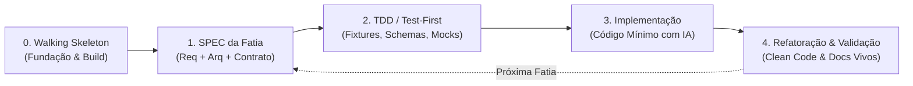

A sua sequência de raciocínio está **conceitualmente muito correta**: você identificou que _entender o problema e projetar a solução deve sempre vir antes de escrever o código_. Isso por si só já evita 90% dos erros cometidos por desenvolvedores que começam a codificar às cegas com IA.

No entanto, no contexto da **engenharia de software moderna e do desenvolvimento assistido por IA**, essa sequência pura (1 a 5 em linha reta) corre o risco de cair no modelo tradicional de **Cascata (_Waterfall_)**, que gera dois grandes problemas:

1. **Análise Excessiva Inicial (_Analysis Paralysis_):** Tentar antecipar todos os requisitos e arquiteturas antes de rodar uma única linha de código.
2. **Falta de Feedback Rápido:** Descobrir que uma decisão de arquitetura não funciona na prática apenas na fase 5 (implementação).

Abaixo apresento a análise crítica da sua lista e a proposta de um fluxo **moderno, iterativo e baseado em fatias verticais (_Vertical Slicing_)**.

---

### 🔍 Análise Crítica dos Pontos

- **1. Requisitos & 2. Arquitetura & 3. Design:**
  - _Ponto Forte:_ Essencial para dar contexto à IA.
  - _Ajuste Moderno:_ Em vez de fazer documentos gigantescos para o sistema inteiro, a metodologia moderna condensa esses três passos em uma **`SPEC.md` focada em uma fatia funcional do problema**. A `SPEC` já contém a regra de negócio (Requisito), a decisão de componentes (Arquitetura) e os contratos/interfaces (Design).
- **4. Testes (TDD):**
  - _Ponto Forte:_ Excelente prática. O TDD funciona como uma "luva" para a IA: se você entrega os testes primeiro, a IA tem um objetivo matemático claro (fazer os testes passarem sem inventar código desnecessário).
- **O que estava faltando na sequência original:**
  - **O "Walking Skeleton" (Fundação):** Antes de testar qualquer lógica de negócio, você precisa de um esqueleto mínimo que compila, roda e possui dependências configuradas (ex: projeto Maven/Gradle com Spring Boot ou Jakarta REST que sobe e responde um `GET /actuator/health`).
  - **Ciclo de Feedback em Homologação:** No mundo fiscal brasileiro, a validação só termina quando o Sefin Nacional responde com sucesso.

---

### 🚀 A Sequência Moderna: _Spec-Driven Development em Fatias Verticais_

Na engenharia moderna assistida por IA, dividimos o projeto em **fatias verticais finas** e aplicamos o ciclo completo em cada uma delas:

#### Passo 0: _Walking Skeleton_ (Fundação Inicial)

- Configuração do projeto base (pom.xml/gradle, Java 17+, dependências centrais).
- Garantir que o comando `mvn clean test` ou `gradle test` execute com sucesso no terminal.

#### Passo 1: Especificação da Fatia Funcional (`SPEC.md`)

- Você não define a API inteira de uma vez. Você define a **Fatia 1**.
- _O que a SPEC contém:_
  - O que o ERP envia (Contrato JSON/XML).
  - Quais regras e schemas (XSD) devem ser validados.
  - O que deve ser retornado (DTOs de resposta).

#### Passo 2: Test-First & Fixtures (TDD)

- Coletar ou gerar arquivos de exemplo reais (ex: um XML de DPS válido e um inválido fornecidos pelo Sefin).
- Criar os testes unitários que falham (_Red phase_):
  - `deveValidarXmlComSucessoContraSchemaXSD()`
  - `deveAssinarDocumentoComCertificadoA1()`
  - `deveRejeitarXmlComCpfInvalido()`

#### Passo 3: Implementação Assistida por IA (_Green Phase_)

- Você passa a `SPEC.md` e os testes para o agente de IA.
- A IA implementa o código estritamente necessário para fazer a suite de testes passar, sem "alucinar" funcionalidades que não foram pedidas.

#### Passo 4: Refatoração, Validação e Documentação Viva

- Limpar o código (_Refactor phase_), aplicar boas práticas (SOLID, Clean Architecture).
- Testar contra o ambiente de homologação da Receita.
- Atualizar o `README.md` com os endpoints que acabaram de ser concluídos.

---

### 💡 Como aplicar isso no `nfse-nacional-api`?

Em vez de tentarmos fazer Emissão + Cancelamento + Consulta + Dashboard tudo de uma vez, nós organizamos em **3 Fatias Verticais Incrementais**:

- **Fatia 1 (Core de Processamento Local):**
  - _Spec:_ Validação XSD da DPS e Assinatura Digital A1 via `assinador-xml-java`.
  - _TDD:_ Testes locais com certificados de teste e XMLs de exemplo (100% offline).
- **Fatia 2 (Transmissão & mTLS):**
  - _Spec:_ Conexão segura TLS mútuo com o Sefin Nacional (Homologação).
  - _TDD:_ Testes de integração e cliente HTTP do Sefin.
- **Fatia 3 (Exposição da API REST para o ERP):**
  - _Spec:_ Endpoints REST (`POST /api/v1/dps/emitir`), documentação Swagger/OpenAPI e tratamento de erros do ERP.
  - _TDD:_ Testes de controllers e payload de entrada.

Essa abordagem garante que você tenha um **software funcionando e testado desde o primeiro dia**, reduz riscos e aproveita a IA com eficiência máxima!

O que acha de começarmos pelo **Passo 0 (Walking Skeleton / Fundação Java do repositório)**?
