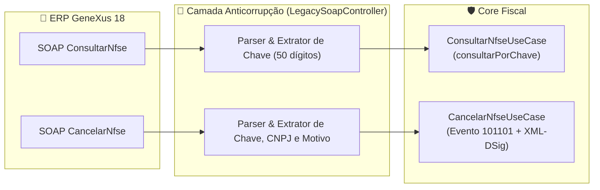

# SPEC-004: Extensão da Camada Anticorrupção (ACL GeneXus) para Consulta e Cancelamento SOAP

> **Status:** `Aprovado`  
> **Autor(a):** @heviane  
> **Data de Criação:** 2026-11-09 &bull; **Última Atualização:** 2026-11-09  
> **Épico Relacionado:** [Épico 6 — Exposição da API REST, Camada Anticorrupção & Deploy BrasilCloud](https://github.com/heviane/nfse-nacional-api/issues/7)  
> **Milestone:** [`v0.4.0 - API REST, Camada Anticorrupção & Deploy BrasilCloud`](https://github.com/heviane/nfse-nacional-api/milestone/4)

---

## 1. 🎯 Contexto e Objetivo de Negócio

* **Contexto:** A **Camada Anticorrupção (ACL)** implementada em `LegacySoapController` já atende com sucesso a operação primária de emissão de NFS-e (`GerarNfse`), traduzindo o envelope SOAP legado do GeneXus 18 para o padrão da NFS-e Nacional (Sefin Nacional / ADN). No entanto, o ERP GeneXus do Cliente 001 pode, dependendo da parametrização do faturamento, disparar chamadas WebService para:
  1. **Consulta de NFS-e:** Verificar a situação da nota ou recuperar o XML autorizado após uma oscilação de rede (`ConsultarNfse`).
  2. **Cancelamento de NFS-e:** Registrar o cancelamento de uma nota diretamente a partir da tela de cancelamento de vendas do ERP (`CancelarNfse`).
* **Objetivo:** Esta especificação define formalmente os contratos WSDL, mensagens SOAP, mappers de tradução e tratamento de retornos para estender o `LegacySoapController`, aproveitando os casos de uso já existentes e testados no Core Fiscal (`ConsultarNfseUseCase` e `CancelarNfseUseCase`).
* **Valor Entregue:** Garante que o cliente não precise recorrer a portais manuais ou ferramentas externas para consultar ou cancelar notas, mantendo a promessa de **zero modificações no ERP GeneXus 18**.

---

## 2. 📋 Requisitos Funcionais (RF)

| ID | Requisito | Prioridade | Critérios de Aceite (Gherkin / Cenários) |
| :--- | :--- | :---: | :--- |
| **RF-01** | **Consulta de NFS-e via SOAP (`ConsultarNfse`)** | `P1` | **Dado** um envelope SOAP com a operação `ConsultarNfse` contendo a Chave de Acesso Nacional de 50 dígitos,<br>**Quando** processado pelo `LegacySoapController`,<br>**Então** deve delegar a consulta ao `ConsultarNfseUseCase` e empacotar a resposta no envelope `<ConsultarNfseResponse>` com o XML da nota e código de status formatados para o GeneXus. |
| **RF-02** | **Cancelamento de NFS-e via SOAP (`CancelarNfse`)** | `P1` | **Dado** um envelope SOAP com a operação `CancelarNfse` contendo chave de 50 dígitos, CNPJ emitente e motivo do cancelamento,<br>**Quando** processado pelo `LegacySoapController`,<br>**Então** deve construir a `RequisicaoCancelamentoDps`, acionar o `CancelarNfseUseCase` (evento 101101 com assinatura digital) e retornar `<CancelarNfseResult>` estruturado. |
| **RF-03** | **Tolerância a Formatos de Payload (Texto, CDATA, Entidades)** | `P0` | **Dado** que o GeneXus 18 envie o XML interno com tags escapadas (`&lt;...&gt;`) ou encapsulado em `<![CDATA[...]]>`,<br>**Quando** o controlador extrair os dados da requisição,<br>**Então** deve decodificar os nós XML com a mesma tolerância aplicada no fluxo de emissão. |
| **RF-04** | **Tratamento Seguro de Erros e Correlation-ID** | `P0` | **Dado** uma exceção de validação, erro no Sefin Nacional ou falha de certificado,<br>**Quando** responder ao ERP,<br>**Então** deve retornar um envelope SOAP HTTP 200 contendo mensagem explicativa controlada (sem vazamento de stacktrace ou credenciais) e `X-Correlation-ID` no log/cabeçalho. |

---

## 3. ⚙️ Requisitos Não-Funcionais (RNF)

* **Performance:** Tempo de resposta da tradução SOAP e acionamento do Core < 250ms (excluindo a latência de rede do Sefin Nacional).
* **Segurança:** Manipulação estrita de certificados A1 em memória via `CertificadoProvider`.
* **Compatibilidade WSDL:** O WSDL gerado dinamicamente em `GET /prefeitura/notafiscal/nfse.asmx?WSDL` deve publicar as operações `GerarNfse`, `ConsultarNfse` e `CancelarNfse` no mesmo binding SOAP `NfseSoap`.

---

## 4. 🏛️ Arquitetura e Contratos WSDL Estendidos

### 4.1. Definições de Tipos e Mensagens no WSDL (SIL Tecnologia)

```xml
<!-- Extensão dos tipos do Schema WSDL -->
<s:element name="ConsultarNfse">
  <s:complexType>
    <s:sequence>
      <s:element minOccurs="0" maxOccurs="1" name="xmlEnvio" type="s:string" />
    </s:sequence>
  </s:complexType>
</s:element>
<s:element name="ConsultarNfseResponse">
  <s:complexType>
    <s:sequence>
      <s:element minOccurs="0" maxOccurs="1" name="ConsultarNfseResult" type="s:string" />
    </s:sequence>
  </s:complexType>
</s:element>

<s:element name="CancelarNfse">
  <s:complexType>
    <s:sequence>
      <s:element minOccurs="0" maxOccurs="1" name="xmlEnvio" type="s:string" />
    </s:sequence>
  </s:complexType>
</s:element>
<s:element name="CancelarNfseResponse">
  <s:complexType>
    <s:sequence>
      <s:element minOccurs="0" maxOccurs="1" name="CancelarNfseResult" type="s:string" />
    </s:sequence>
  </s:complexType>
</s:element>
```

### 4.2. Mapeamento de Portas e Casos de Uso do Core



---

## 5. 🧪 Estratégia de Testes Automatizados

- [ ] **Teste Unitário (WSDL Estendido):** Validar que `GET /prefeitura/notafiscal/nfse.asmx?WSDL` expõe `GerarNfse`, `ConsultarNfse` e `CancelarNfse`.
- [ ] **Teste de Integração MockMvc (Consulta):** Simular requisição SOAP com `<ConsultarNfse>` e verificar retorno `<ConsultarNfseResult>` contendo o XML da NFS-e autorizada.
- [ ] **Teste de Integração MockMvc (Cancelamento):** Simular requisição SOAP com `<CancelarNfse>` e verificar geração de evento com código de status de cancelamento homologado.
- [ ] **Teste de Resiliência:** Simular envelope SOAP com parâmetros ausentes ou chave malformada (< 50 dígitos) e garantir retorno SOAP com mensagem amigável para o ERP.

---

## 6. 🚦 Critérios de Ativação em Produção

> [!NOTE]
> **Condição de Homologação:** A implementação de código no `LegacySoapController` para as rotas de consulta e cancelamento SOAP deve ser ativada assim que o Cliente 001 disponibilizar amostras reais dos envelopes gerados pelo GeneXus 18 para essas operações específicas, mitigando suposições e garantindo total fidelidade com os tipos de dados do ERP. Enquanto isso, o Core Fiscal e a API REST já oferecem essas capacidades em `/api/v1/nfse/{chave}` e `/api/v1/nfse/cancelar`.
